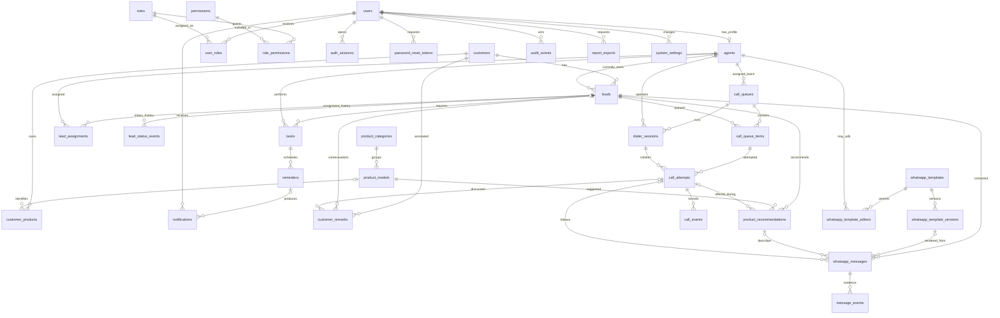

# Current MySQL implementation — 15 November 2026

This section is authoritative for working Laravel code. The original source analysis follows as a historical prototype reference and a proposed long-term schema. No PostgreSQL database or RLS policy is used.

## Implemented tables and tenancy

- organisations/branches/branch_memberships: CHAR(36) organisation and branch identities; bigint user IDs; unique membership and composite organisation+branch FKs. Explicit active membership is required even for System Admin. Customers belong to the company.
- Spatie permissions/roles/model_has_roles/model_has_permissions/role_has_permissions: role definitions and role assignments are organisation-scoped using the teams feature and organisation_id UUID FKs. Permission definitions are global capability metadata. Runtime credentials can read but cannot mutate grants.
- customers: UUID, organisation_id, branch_id, display_name, phone (international format), encrypted ic TEXT, hidden last-four projection, address, legacy_hp_code, lifecycle_status, do_not_call, version, timestamps and deleted_at. No unmasked IC is serialized. Current IC input accepts optional 12-digit Malaysian identifiers; other ID formats need an approved policy.
- customer_products: primary installation data with customer FK constrained by organisation+branch; legacy product name, exact-day dates where known and contract_months. The current editor manages the first installation; multi-installation UI is pending. Blank IC retains the previous encrypted value; deleting an installation/IC is not exposed.
- leads: separate customer-linked action_status, latest remark and version, scoped by organisation+branch. Creation makes one initial lead; the UI updates the latest lead. Historical notes/status events and multiple-case editing are pending.
- tasks: scoped lead FK, assigned_user_id constrained to the same branch membership, title, description, due_on, status, completed_at and version. Assignee must also be active at assignment time. Dates are calendar dates; no automatic notification worker exists yet.
- product_categories/product_models: organisation-wide catalog (no branch_id), composite category FK, model code unique per organisation, MYR monthly decimal price, description, active flag and version. Recommendations/message history are not implemented yet.
- audit_events: UUID, organisation_id, branch_id, actor_user_id, action, entity_type/id, safe JSON metadata and timestamps. Runtime receives SELECT/INSERT only. Passwords, IC, addresses, message bodies and remark content are excluded from metadata.
- Framework users/password_reset_tokens/sessions/passkeys are global authentication infrastructure. User tenancy is represented by memberships, not a client-supplied organisation field. Existing auth bigint IDs are preserved rather than converted to UUIDs.

## Enforcement and current boundaries

UseTenantWorkspace resolves active branch from server session and verifies stored membership through TenantTransaction on every request. TenantContext exists only for that transaction and is cleared on success/failure. Spatie organisation context and cached user relations are cleared afterward. Customer/Task policies and controller permissions supplement fail-closed Eloquent scopes. Tenant IDs in write payloads are prohibited. Composite FKs prevent cross-tenant associations. MySQL CHECK constraints enforce nonnegative prices, positive versions/contract lengths, installation date order and consistent task completion timestamps. Mutation actions own explicit transactions; HTTP error responses also roll back the tenant request. Validation redirects cannot cause partial customer/lead/installation commits. MySQL has no native RLS: raw query-builder access must be explicitly scoped and reviewed; it is used only for authenticated membership resolution, scoped aggregate/projection queries and append-only audits.

Administrative roles must complete Fortify TOTP setup before CRM access. Agent has customer read/update, own task progress and catalog read access. Current administrators operate inside explicit branch membership; cross-branch HQ aggregation and organisation provisioning UI remain pending. Registration is disabled; email invitations remain pending.

Migrations: 2026_11_13_000001_create_tenant_foundation, 2026_11_15_000001_create_permission_tables, 2026_11_15_000002_create_crm_tables, 2026_11_15_000003_add_crm_integrity_checks. Application uses restricted skybound_app grants; migrations and role provisioning use an administrator connection. Never run test migrations against the application database. See phpunit.mysql.xml and DEVELOPMENT.md for verification and setup.

## Draft statuses and assumptions

Configured in config/crm.php: customer lifecycle active/installation/pending; lead new/no_answer/callback/follow_up/interested/not_interested/closed; tasks open/in_progress/completed/cancelled. These labels remain draft client decisions. Do Not Call is a separate customer suppression flag, independent of sales outcome. Archive is soft deletion and is refused while tasks remain open/in_progress. Reports include active customer records only, use creation time in UTC, and never export IC. CSV formula prefixes are neutralized. Full historical attribution, PDF/filesystem exports and retention scheduling remain pending.

---

# SKYBOUND HQ — Data architecture

## 1. Scope, evidence, and reading conventions

This document describes the data actually present in `skybound_hq_auto_dialing_prototype.html` and a **Proposed** production relational design. Read [flow.md](flow.md) for execution behavior and [module.md](module.md) for UI, function, and module coverage. Analysis date: 12 November 2026, Asia/Kuala_Lumpur.

The repository contained only the 1,456-line HTML file before this documentation was added. There are no migrations, SQL definitions, server files, dependency manifests, authentication services, or database connections. An HTML comment referring to a PPT is not evidence of an available presentation. No existing database tables are claimed here.

Labels used throughout all three documents:

| Label | Meaning |
|---|---|
| **Implemented** | Code performs the stated browser operation; this does not imply persistence or production readiness. |
| **Simulated** | Demo content, a local stand-in, an inert control, or a success claim without the corresponding system operation. |
| **Proposed** | Recommended future design; absent from the source. |
| **Requires Clarification** | Business meaning or policy cannot be established from the source. |

Source references use the original HTML's one-based line numbers. Key anchors: static UI 202–855; customer seed/state 876–901; catalog 904–923; initialization 926–930; dialer 963–1083; customer renderer/save 1086–1170; messaging/log/reset 1172–1283; enhancements 1310–1451. The later save override, rather than the earlier declaration alone, determines actual persistence behavior.

## 2. Existing prototype data and persistence

### 2.1 Storage boundaries

**Implemented:** `initialQueueData` is an array of 15 customer objects. `queue` is its JSON deep clone. Every page shares the same script and DOM. Changes to `queue` survive navigation but disappear on reload. No localStorage, sessionStorage, IndexedDB, cookies, fetch/XHR, or backend client occurs in the application source. External CSS, scripts, fonts, avatar images, product images, and `wa.me` links do make external resource requests; absence of a backend does not mean an offline application.

The HTML UI's phrase “sesi browser” means in-memory document lifetime here, not persisted browser session storage. Agent cards, database rows, reminders, filters, and editable textareas have separate DOM state. A change to one representation generally does not synchronize the others.

### 2.2 Existing object dictionary

| Structure / field | Actual type / initial value | Meaning and actual consumers |
|---|---|---|
| `initialQueueData[].id` | integer 1–15 | Demo customer identifier; not used for joins or shortcut lookup. |
| `.name` | string | Display, name-based `findIndex`, logs, export, generated greeting. Names are not guaranteed unique. |
| `.phone` | formatted string | Queue/profile, logs, exports, WhatsApp digit stripping. No calling gateway consumes it. |
| `.ic` | string | Identity number displayed in editable IC input; edits are not saved. Sensitive personal data in a real deployment. |
| `.product` | string | Existing installed product label; not a product-model FK. |
| `.status` | string | Mixed lead, installation, interest, and package-change concepts; displayed in profile select and exported. |
| `.address` | string | Profile population. Original save writes it; effective override does not. |
| `.installDate`, `.expireDate` | localized month/year strings | Editable display values; not dates, not saved. |
| `.callStatus` | string; initially `Belum dihubungi` | Mutable last call display status, not call history. |
| `queue[].remark` | string, added only on effective Save | Last remark input value; never restored by `showCustomerDetails`. |
| `.reminderDate`, `.whatsAppDate` | strings, added on Save | Resolve to `''` in supplied HTML because both corresponding controls are absent. No scheduler consumes them. |
| `productsData[category][]` | object arrays | Four categories, nine models; read-only catalog in JavaScript. |
| Product `.id`, `.name`, `.price`, `.desc`, `.img` | strings | IDs such as `w1`; price is display text, not money; description and remote placeholder image URL. |
| `customWhatsAppTemplates` | object of three strings | Keys `manager`, `custom1`, `custom2`; manager value can mutate. No author, version, or permission relation. |

Queue seed names in order: Alucard, Miya, Layla, Zilong, Fanny, Gusion, Lesley, Chou, Kagura, Lancelot, Angela, Ling, Melissa, Xavier, Fredrinn. All 15 start uncontacted. The first ten include statuses `Pending`, `Berminat Follow-up`, `Pemasangan Produk`, `Berminat`, `Belum pasti`, and `Tukar Pakej`; the last five are `Pending`. Existing products include washer/dryer and massage chair descriptions even though those categories do not exist in the recommendation catalog.

Catalog identifiers and monthly display prices, from lines 904–923:

| Category key | Models (ID: name — MYR/month) |
|---|---|
| `water` | `w1`: Penapis Air Villaem III — 77; `w2`: Penapis Air Ombak — 120; `w3`: Penapis Air Neo Plus — 65 |
| `air` | `a1`: Penapis Udara Storm — 70; `a2`: Penapis Udara Noble — 140 |
| `ac` | `c1`: Aircond Smart Inverter 1.0HP — 90; `c2`: Aircond Smart Inverter 1.5HP — 110 |
| `mattress` | `m1`: Coway Prime Mattress King — 139; `m2`: Coway Prime Mattress Queen — 119 |

These are demo catalog values and marketing descriptions, not verified product specifications or prices.

### 2.3 Transient state and DOM records

| State | Initial value | Responsibility / limitation |
|---|---|---|
| `currentIndex` | `-1` | Both selected customer and nominal dial target. Mutating selection can detach it from a running timer's captured customer. |
| `isDialing` | `false` | Auto-advance flag; not reliable proof a timer is running. Skip starts timers without setting it. |
| `countdownTimer` | `null` | Interval handle only; next-customer timeout handles are not retained. |
| `timerSeconds` | `30` | Decremented on interval callbacks; reset does not restore it. |
| `answeredCount`, `unansweredCount` | `0`, `0` | Incremental counters without distinct attempt identity. Repeated answers inflate totals. |
| `selectedCategoryKey` | `water` | Current recommendation category. |
| `currentLeadAction` | `Follow Up` | Written by unbound `setLeadAction`; effective Save never reads this variable. |
| `agentPhotoDraft` | `''` | FileReader data URL for one open agent modal; local only. |
| `call-log-tbody` rows | placeholder | Newest-first DOM history, localized time only; no array, ID, date, FK, duration, actor, or durable event store. |
| Customer profile fields | mixed static defaults | Remarks and contract selection are not populated per customer; some fields accept unsupported values. |
| Agent cards | four static blocks | Name, phone, code, avatar and performance figures; editor changes DOM only. |
| Reporting controls | blank dates, all agents | Agent selection changes export header only; dates unused. |

Actual log statuses are `DIJAWAB`, `Tidak Dijawab`, and `WhatsApp Dihantar`. Queue statuses are `Belum dihubungi`, `Sedang dipanggil...`, `DIJAWAB (Panggilan Aktif)`, `Tidak dijawab (Timeout 30s)`, and `Dilangkau`. Do not treat these two representations as a shared enum.

### 2.4 Disconnected records and ambiguous identifiers

**Simulated:** the database page has three independent static rows (Zilong / HP CODE 11, Lunox / 22, Valir / 33), with IC, existing product, address, lifecycle label, installation month, and action select. There is no synchronization to the 15-item queue. Zilong's shortcut phone differs from queue Zilong; Lunox's actions target Miya; Valir is absent from the queue. Dashboard reminder rows display Layla and Aminah Jaya but target Senah binti Kasim and Miya respectively. Senah is absent from the queue.

Agent cards show Zilong, Fanny, Layla, Minotaur with `AGENT-01` through `AGENT-04`, four local phone numbers, and fixed totals. Customer names overlapping agent names do not establish identity or ownership. Dropdown agent names are hardcoded and do not track edited cards. Dashboard “8 agents” is not derived from these four cards.

**Requires Clarification:** whether customer HP CODE is an owner code, imported record code, telephone extension, or something else. It must not be automatically joined to agent “Hp Code.” The Admin badge's “Ejen #102” is also static display, not an authenticated account.

## 3. Proposed production model and conventions

All tables below are **Proposed**, including authentication, tasks, campaigns, and message records. A relational database with transactional constraints is appropriate because ownership, assignments, attempts, permissions, and history must remain consistent. MySQL 8.4 is the confirmed production engine. Logical UUIDs map to CHAR(36); timestamps use UTC DATETIME(6), encrypted ciphertext uses TEXT, JSON uses MySQL JSON and decimal prices use DECIMAL(12,2). Proposed tables below remain a design dictionary; the implemented schema is listed in the current-state section above.

Objectives: establish immutable identifiers; separate customer identity from sales leads and installed products; retain assignment and interaction history; isolate call state from selection state; support authorized reporting; prevent duplicate provider events and concurrent dial attempts; preserve message content at the time of handoff; record audited changes without duplicating sensitive payloads needlessly.

Dictionary conventions:

- Every table has `id uuid PK` unless a composite PK is explicitly listed. All fields are NOT NULL unless marked `?` (nullable). UUID generation strategy is a deployment decision.
- Mutable master/aggregate tables additionally have `created_at datetime(6)`, `updated_at datetime(6)`, `version bigint DEFAULT 1 CHECK > 0`; these are included by convention rather than repeated in each row. Immutable events have `created_at datetime(6)` only. Junctions specify their own dates where needed.
- All `_id` references below are FKs to the named table's `id`; use restrictive deletes by default for historical/business data. Do not cascade-delete customer call/message history.
- Store instants in UTC; display in a configured business timezone, initially proposed as Asia/Kuala_Lumpur. A calendar due date is `date`; a scheduled notification is `datetime(6)`. Never manufacture a day for a source value containing only month/year.
- `text` status columns require explicit CHECK/lookup constraints with the values in section 5. Length bounds and accepted content are enforced at API boundaries as well as schema level.
- Identity numbers and phones are strings, never numeric quantities. Money uses decimal numeric values with a currency and billing interval, not `RM … / bulan` text.

### 3.1 Identity and access tables

| Table / purpose | Columns in addition to conventions | Constraints / indexes |
|---|---|---|
| `users` — login principals | `email text`, `display_name text`, `password_hash text?`, `external_subject text?`, `status text`, `last_login_at datetime(6)?` | Unique normalized email; optional unique external subject. Active/disabled/invited states. Credentials may be delegated to an identity provider; do not require local passwords in that case. |
| `agents` — operational agent profile | `user_id uuid -> users`, `agent_code text`, `phone_e164 text?`, `photo_asset_key text?`, `status text` | Unique `user_id` gives users 0..1 agent profile; unique normalized agent code. Phone is not automatically unique across users. |
| `roles` — role definitions | `code text`, `name text` | Unique code; System Admin, HQ Admin, Branch Manager and Agent. Editor is a capability rather than an approved additional role. |
| `permissions` — capabilities | `code text`, `description text` | Unique stable code, e.g. `customer.read`, `lead.assign`, `template.edit`, `report.export`. |
| `user_roles` — user/role M:N | `user_id uuid -> users`, `role_id uuid -> roles`, `granted_by_user_id uuid -> users`, `granted_at datetime(6)` | Composite PK `(user_id, role_id)`; index role-to-users. No ordinary mutable-record convention. |
| `role_permissions` — role/capability M:N | `role_id uuid -> roles`, `permission_id uuid -> permissions` | Composite PK `(role_id, permission_id)`; reverse index. |
| `auth_sessions` — revocable sessions | `user_id uuid -> users`, `token_hash text`, `expires_at datetime(6)`, `revoked_at datetime(6)?`, `created_at datetime(6)` | Unique token hash; indexes `(user_id, expires_at)` and expiry cleanup. Hash tokens, never store reusable plaintext session tokens. |
| `password_reset_tokens` — optional local auth resets | `user_id uuid -> users`, `token_hash text`, `expires_at datetime(6)`, `consumed_at datetime(6)?`, `created_at datetime(6)` | Unique hash; one-time atomic consumption. Omit if identity provider owns reset. No reset password field in agent record. |

Object-level ownership checks supplement RBAC. An Agent role alone must not permit access to every customer's identity number. **Requires Clarification:** team scope and Manager hierarchy. Multi-tenancy is confirmed. Organisations and authorised branch memberships are mandatory; no role grants cross-organisation access implicitly.

### 3.2 Customers, installed products, leads, and work

| Table / purpose | Columns | Constraints / indexes |
|---|---|---|
| `customers` — stable customer identity | `display_name text`, `ic_ciphertext text?`, `ic_lookup_hash text?`, `primary_phone_e164 text?`, `address_text text?`, `lifecycle_status text`, `legacy_hp_code text?`, `source_reference text?` | Index searchable normalized name and phone as supported by privacy policy. IC hash only if justified for equality lookup; protect key material separately. Unique IC policy requires confirmation; shared phones must be permitted pending deduplication rules. |
| `customer_products` — customer installation/contract facts | `customer_id uuid -> customers`, `product_model_id uuid? -> product_models`, `legacy_product_name text?`, `installed_on date?`, `expires_on date?`, `installed_month date?`, `expires_month date?`, `contract_months integer?`, `status text` | Preserve unknown model names instead of forced matching. Month fields use first-of-month plus explicit month semantics; do not populate exact-day fields simultaneously for the same fact. Positive contract months; expiry >= installation when comparable. Index `(customer_id, status)` and expiry. |
| `leads` — sales/follow-up case | `customer_id uuid -> customers`, `owner_agent_id uuid? -> agents`, `action_status text`, `service_intent text?`, `source text?`, `closed_at datetime(6)?`, `created_by_user_id uuid -> users` | Index `(owner_agent_id, action_status, updated_at)` and customer. Multiple leads per customer proposed to preserve separate campaigns/opportunities; whether only one may be open per customer is unresolved. |
| `lead_assignments` — historical ownership | `lead_id uuid -> leads`, `agent_id uuid -> agents`, `assigned_by_user_id uuid -> users`, `assigned_at datetime(6)`, `ended_at datetime(6)?`, `reason text?` | Immutable periods except closing an active interval. A stored generated nullable `active_lead_id = CASE WHEN ended_at IS NULL THEN lead_id END` with UNIQUE(active_lead_id), plus historical indexes; end >= start; synchronize `leads.owner_agent_id` in one transaction. |
| `tasks` — assigned follow-up work | `lead_id uuid -> leads`, `assigned_agent_id uuid -> agents`, `kind text`, `status text`, `due_on date?`, `scheduled_at datetime(6)?`, `timezone text`, `completed_at datetime(6)?`, `created_by_user_id uuid -> users`, `description text?` | Kind call_back/follow_up/whatsapp/service; status open/in_progress/completed/cancelled. Index `(assigned_agent_id, status, due_on)`. Completion requires completed timestamp. Calendar due date and exact schedule must have explicit semantics. |
| `customer_remarks` — durable notes | `customer_id uuid -> customers`, `lead_id uuid? -> leads`, `call_attempt_id uuid? -> call_attempts`, `author_user_id uuid -> users`, `body text`, `created_at datetime(6)` | Nonblank bounded body; append-only or audited edit policy. If lead or attempt is present, require same customer through validated references/transaction checks. Index `(customer_id, created_at DESC)`. |
| `lead_status_events` — status history | `lead_id uuid -> leads`, `previous_status text?`, `next_status text`, `changed_by_user_id uuid -> users`, `reason text?`, `created_at datetime(6)` | Insert with lead update atomically; index `(lead_id, created_at)`. A generic audit record alone is not a convenient reportable status timeline. |
| `reminders` — notification schedule | `task_id uuid -> tasks`, `recipient_user_id uuid -> users`, `scheduled_at datetime(6)`, `status text`, `channel text`, `dedupe_key text`, `sent_at datetime(6)?`, `failure_reason text?` | Unique dedupe key; pending/sent/failed/cancelled; index `(status, scheduled_at)` for worker claims. Multiple reminders per task, including escalation if approved. |

Ownership is on a lead, while a task has its own assignee. This supports a single customer with multiple work items without silently moving all historical calls when an agent changes. Customer records are owned by the organisation; assignment controls work responsibility and never transfers customer ownership. Do not infer ownership from matching display names.

### 3.3 Catalog and recommendation tables

| Table / purpose | Columns | Constraints / indexes |
|---|---|---|
| `product_categories` | `code text`, `name text`, `is_active boolean`, `sort_order integer` | Unique code; initial mappings water/air/ac/mattress. Deactivate rather than delete referenced categories. |
| `product_models` | `category_id uuid -> product_categories`, `model_code text`, `name text`, `description text`, `monthly_price numeric(12,2)?`, `currency char(3)`, `billing_interval text`, `image_asset_key text?`, `is_active boolean` | Unique model code; nonnegative price; initial currency MYR and monthly interval; index `(category_id, is_active)`. Free-text legacy products remain separate. |
| `product_recommendations` | `lead_id uuid -> leads`, `product_model_id uuid -> product_models`, `call_attempt_id uuid? -> call_attempts`, `recommended_by_user_id uuid -> users`, `price_snapshot numeric(12,2)?`, `currency char(3)`, `note text?`, `created_at datetime(6)` | Lead/model M:N over time; retain offered price snapshot. Index `(lead_id, created_at)`. Optional call must belong to lead. |

The prototype merely previews a chosen model. Persisting `product_recommendations` is **Proposed**; no recommendation record, sale, order, payment, or installation job is created by current product selection or WhatsApp handoff. Whether “close produk” requires an order pipeline is unresolved.

### 3.4 Dialer and call history tables

| Table / purpose | Columns | Constraints / indexes |
|---|---|---|
| `call_queues` — ordered work batch | `name text`, `assigned_agent_id uuid -> agents`, `created_by_user_id uuid -> users`, `status text`, `timeout_seconds integer`, `next_call_delay_seconds integer` | Proposed defaults 30 and 1 from demo. Positive bounded timeout; delay >= 0. Index agent/status. A campaign entity is deferred until campaign requirements exist. |
| `call_queue_items` — queue membership | `queue_id uuid -> call_queues`, `lead_id uuid -> leads`, `position integer`, `status text`, `last_attempt_id uuid? -> call_attempts`, `claimed_by_session_id uuid? -> dialer_sessions` | Unique `(queue_id, position)`; unique `(queue_id, lead_id)` proposed unless retries need explicit duplicate membership. Position >= 1. Index `(queue_id, status, position)`. Validate referenced attempt belongs to this item. |
| `dialer_sessions` — run/pause boundary | `queue_id uuid -> call_queues`, `agent_id uuid -> agents`, `status text`, `current_item_id uuid? -> call_queue_items`, `generation bigint`, `started_at datetime(6)`, `ended_at datetime(6)?` | One active session per agent and queue by generated active-key unique constraints. Generation invalidates pending work; item must belong to queue. Persist paused/completed state independently of UI selection. |
| `call_attempts` — one actual/simulated attempt | `queue_item_id uuid -> call_queue_items`, `dialer_session_id uuid -> dialer_sessions`, `agent_id uuid -> agents`, `phone_snapshot text`, `state text`, `outcome text?`, `provider_call_id text?`, `started_at datetime(6)`, `ring_deadline_at datetime(6)?`, `answered_at datetime(6)?`, `ended_at datetime(6)?`, `idempotency_key text` | Unique idempotency key; optional unique provider call ID within provider scope. One nonterminal attempt per queue item/agent; monotonic timestamps; answered calls require answered_at. Index `(agent_id, started_at)` and `(queue_item_id, started_at)`. |
| `call_events` — ordered transition evidence | `call_attempt_id uuid -> call_attempts`, `event_type text`, `provider_event_id text?`, `occurred_at datetime(6)`, `received_at datetime(6)`, `actor_user_id uuid? -> users`, `payload_redacted json?` | Unique provider event ID within provider scope; append-only. Index `(call_attempt_id, occurred_at)`. Deduplicate repeated callbacks; tolerate delivery out of order. |

The prototype has no provider names, provider credentials, inbound webhooks, recordings, media sessions, call duration, or billing. Provider-specific schema and hang-up semantics are **Requires Clarification**. Separate queue-item disposition from attempt outcome: a skipped item is not necessarily an unanswered call; a retried customer can have several attempts. Counters should be derived from distinct attempts and accepted terminal events, not button clicks.

### 3.5 Templates, permissions, and messages

| Table / purpose | Columns | Constraints / indexes |
|---|---|---|
| `whatsapp_templates` — logical template | `key text`, `name text`, `owner_user_id uuid? -> users`, `kind text`, `editor_limit integer?`, `is_active boolean` | Unique key per chosen scope. kind manager/custom; nonnegative editor limit. Whether limits count users or agent profiles requires agreement. |
| `whatsapp_template_versions` — immutable content | `template_id uuid -> whatsapp_templates`, `revision integer`, `body text`, `created_by_user_id uuid -> users`, `created_at datetime(6)` | Unique `(template_id, revision)`; positive revision and nonblank bounded body. Latest approved revision or explicit version selected by service. Provider approval states are deferred until API integration chosen. |
| `whatsapp_template_editors` — template/agent M:N | `template_id uuid -> whatsapp_templates`, `agent_id uuid -> agents`, `granted_by_user_id uuid -> users`, `granted_at datetime(6)` | Composite PK `(template_id, agent_id)`; reverse index. Check editor-count limit while locking template row to prevent concurrent grants exceeding quota. |
| `whatsapp_messages` — handoff/API history | `lead_id uuid -> leads`, `call_attempt_id uuid? -> call_attempts`, `recommendation_id uuid? -> product_recommendations`, `template_version_id uuid? -> whatsapp_template_versions`, `created_by_user_id uuid -> users`, `recipient_phone_snapshot text`, `body_snapshot text`, `transport text`, `status text`, `provider_message_id text?`, `handoff_at datetime(6)?`, `sent_at datetime(6)?`, `delivered_at datetime(6)?`, `failure_reason text?`, `idempotency_key text` | Unique idempotency key; optional unique provider ID within provider scope. Index `(lead_id, created_at)` and `(status, created_at)`. Optional related records must belong to lead. Store exact edited body, not only template reference. |
| `message_events` — delivery evidence | `message_id uuid -> whatsapp_messages`, `event_type text`, `provider_event_id text?`, `occurred_at datetime(6)`, `received_at datetime(6)`, `payload_redacted json?` | Append-only; provider event deduplication; index `(message_id, occurred_at)`. No fabricated delivery events for browser handoff. |

Proposed `transport` values: `wa_link`, `provider_api`. A wa.me link opening supports only `handoff_requested` or `handoff_opened`, if observable; it never proves `sent`, `delivered`, or `read`. The existing `WhatsApp Dihantar` log label is **Simulated** delivery, not evidence to migrate as a successful message. Browser popup failure should be recorded separately. Retain content only for a justified retention period because message bodies may contain personal data.

### 3.6 Configuration, notifications, auditing, and reporting

| Table / purpose | Columns | Constraints / indexes |
|---|---|---|
| `system_settings` | `key text`, `value json`, `changed_by_user_id uuid -> users` | Unique (organisation_id, key), and branch_id when branch-specific. Schema-validate values by key; protect privileged writes. Secrets belong in a secret store, not this JSON. |
| `notifications` | `recipient_user_id uuid -> users`, `reminder_id uuid? -> reminders`, `kind text`, `body text`, `read_at datetime(6)?`, `created_at datetime(6)` | Index `(recipient_user_id, read_at, created_at)`. Durable inbox is proposed; existing toasts are transient. |
| `audit_events` | `actor_user_id uuid? -> users`, `action text`, `entity_type text`, `entity_id uuid?`, `request_id text`, `changes_redacted json?`, `created_at datetime(6)` | Append-only restricted writer; indexes `(entity_type, entity_id, created_at)` and actor/time. Polymorphic target is intentionally not a FK; preserve entity context even after archival. Exclude passwords, tokens, full IC, and unnecessary message contents. |
| `report_exports` | `requested_by_user_id uuid -> users`, `format text`, `filters json`, `status text`, `row_count bigint?`, `file_asset_key text?`, `expires_at datetime(6)?`, `created_at datetime(6)` | csv/pdf, pending/running/completed/failed; row count >= 0. Index requester/time. Optional for asynchronous or audited exports, not required for every small query. |

Dashboard and agent totals should be **Proposed derived views**, not separately editable counters: lead counts by action/owner, distinct attempts by outcome/time/agent, open tasks by due date, and message handoffs/delivery by evidence. Do not join several one-to-many histories and count raw joined rows; preaggregate or count distinct IDs. Record report timezone, filters, and generation instant. Current exports contain only queue snapshots, not these views.

## 4. Relationship model and ERD

One user has zero or one agent profile; users/roles and roles/permissions are many-to-many. One customer has many installed products and leads. One lead has one nullable current owner, many historical assignment periods, tasks, remarks, recommendations, queue memberships, and messages. Queue membership bridges queues and leads; call attempts belong to queue items and sessions. Templates and editor agents are many-to-many; messages reference immutable template versions. Notifications may originate from reminders. Audit/export/configuration references do not create business ownership.

All names in this diagram are **Proposed** table names. Connector cardinalities describe the design, not actual prototype data. The detailed dictionaries govern optional FKs and constraints.

## 5. Status separation and source mapping

The following normalized vocabulary is **Proposed**, shared with the other documents. Existing strings must remain available in an import staging record until mappings are approved.

| Dimension | Proposed values / source mapping |
|---|---|
| `customers.lifecycle_status` | active / installation_pending / unknown / archived. Static `Aktif` -> active; `Pemasangan` -> installation_pending, subject to confirmation. |
| `leads.action_status` | pending / interested / callback / follow_up / not_interested / closed. `Pending` -> pending; `Berminat` -> interested; `Call Back` -> callback; `Follow Up` -> follow_up; `Tidak Berminat` -> not_interested. `closed` is proposed for reporting intent, with no actual close operation in prototype. |
| `leads.service_intent` | installation / package_change / undecided / other / null. `Pemasangan Produk`, `Tukar Pakej`, `Belum pasti` need agreed separation from lead action; do not silently convert them into sales outcomes. |
| Combined old status | `Berminat Follow-up` requires an agreed primary action plus follow-up task; do not discard its combined meaning. |
| Queue/session status | Queue ready / active / paused / completed / cancelled; session active / paused / completed / cancelled. Item pending / claimed / completed / skipped / cancelled. These are not existing string values. |
| Attempt state/outcome | State ringing / answered / ended. Nullable outcome until terminal: answered / unanswered / skipped / cancelled / failed. Answered state is not proof the conversation has ended. |
| Message status | draft / handoff_requested / handoff_opened / queued / sent / delivered / read / failed / cancelled. Link transport cannot acquire provider evidence states. |
| Task/reminder status | Task open / in_progress / completed / cancelled; reminder pending / sent / failed / cancelled. |

The four-option profile select cannot represent `Pending`, `Berminat`, or `Belum pasti`. Browser select assignment to those values leaves no selected option; Save can replace the source status with `''`. The override's action-status fallback does not help because `cust-action-status` does not exist. This defect is documented, not adopted as a production rule.

## 6. Integrity, security, indexing, and transactions

**Proposed:** normalize to approximately third normal form: customer identity is stored once; installed products are separate repeatable records; agent identity is independent of card text; prices belong to models while recommendations retain snapshots; logs append events rather than overwrite a customer; status and ownership histories are separate from current projections. Do not copy static dashboard or card figures into source-of-truth tables.

Critical atomic operations:

1. Assign/reassign lead: authorize actor; lock lead; close prior assignment interval; insert new interval; update owner/version; append audit event. Decide how existing tasks and active queue items are handled before reassignment.
2. Start next call: claim queue item/session with a transaction or lease; create a distinct attempt and idempotency key; snapshot phone and deadline; prevent a second active attempt for the same agent. A browser timer must not independently own telephony truth.
3. Accept result: deduplicate event; validate allowed transition; update attempt; update queue projection; append call event. Duplicate Answer or late timeout cannot count a second result.
4. Save follow-up: validate customer/lead identity, action, remark, assignee, timezone and due date; commit lead event, note, task and reminder together as appropriate. Pending notification workers must respect cancellation.
5. Save template and editor grants: validate whole request and lock quota row before changing content or grants. Current code mutates content before count validation; do not replicate that partial update.
6. Send/handoff message: snapshot intended customer, recipient, template version, recommendation and edited body; persist handoff evidence. API retries reuse idempotency key. Provider acceptance and delivered/read events are separate.

Review explicit and InnoDB-created indexes on every commonly traversed FK, composite ownership/date indexes for report queries, due-task/reminder indexes, and unique provider identifiers scoped by integration when more than one provider/account exists. Avoid indexing full encrypted PII. Choose pagination and row-level access predicates before performance tuning.

Validate phones in canonical international form with explicit country handling; stripping non-digits is insufficient for local agent numbers. Validate IC only under agreed country/identity policy; demo values are not validation examples. Require nonblank names, valid active model/category relations, bounded note/template lengths, safe image types and sizes, permitted date ranges, positive integer contract durations and timeouts, and date-from <= date-to. Enforce constraints server-side regardless of HTML attributes.

Use parameterized database access, encoded DOM rendering, secure session cookies or equivalent authentication, authorization on every read/write/export, and restricted PII visibility. Current HTML interpolation in logs, queue rendering, agent editing, and print output is unsafe for future untrusted data. CSV quoting alone does not mitigate spreadsheet formula injection. Product/agent images should be validated managed assets rather than arbitrary executable or tracking content.

**Requires Clarification:** retention and deletion periods, consent/contact preferences, legal basis for identity data, handling do-not-contact requests, export rights, encryption and key management, call recording needs, tenancy, and manager scope. No existing consent fields or suppression logic should be implied. A production design must define these policies before dialing real customers; this analysis does not assert a specific legal rule.

## 7. Migration and reporting interpretation

The original HTML has no database to migrate. The Laravel MySQL schema is now live locally. Any future prototype seed/import process should:

1. Preserve the original seed/static row representation and provenance separately during reconciliation; never ingest source HTML as trusted markup.
2. Import the 15 queue customers with stable external IDs. Compare the three database rows and two reminders manually; mismatched names/phones/ICs cannot be auto-merged safely.
3. Import catalog codes and decimal prices; keep existing product descriptions as legacy names where exact models are unavailable. Preserve month precision and localized month names during date parsing.
4. Create real users and agents through an invitation workflow. Do not infer users from customer names or the hardcoded Admin badge.
5. Resolve status taxonomy and HP CODE meaning. Import no fabricated ownership, delivery, completed tasks, sales, or notification histories from decorative counts.
6. Seed templates as content, not as proven permission grants. No permitted-agent relationship is actually retained by the source.
7. Rebuild all dashboard/report projections from authoritative rows and timestamps. Define denominators: attempts versus distinct leads, call result date versus lead creation date, reassigned owner versus historical acting agent, and sent versus handed-off WhatsApp counts.

## 8. Unresolved design decisions

**Requires Clarification:** broader HQ/platform administration scope beyond explicit branch memberships; multiple active leads per customer; campaign membership and retry policy; meaning of close/completed; manual skip outcome during an answered conversation; post-answer wrap-up/hang-up; permission quota scope; personal versus shared custom templates; reminder time, channel, escalation and recurrence; contract precision; catalog pricing history and sale recording; gateway/provider integration and contact permissions. These decisions influence constraints and APIs and should not be hidden behind defaults.

The schema deliberately does not add payments, orders, invoices, inventory, commissions, or recordings without source-backed requirements. Its entities cover the demonstrated customer/call/product/template interactions and the explicitly requested production follow-up, access, audit, and reporting foundations.

