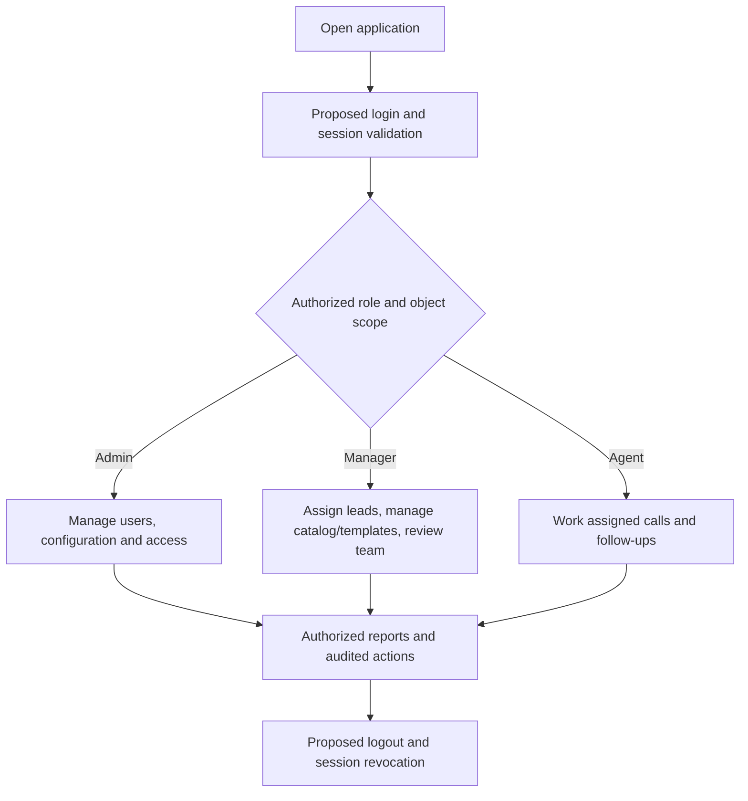
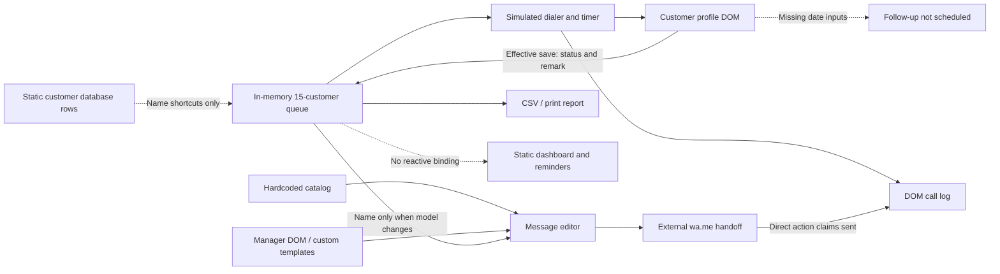
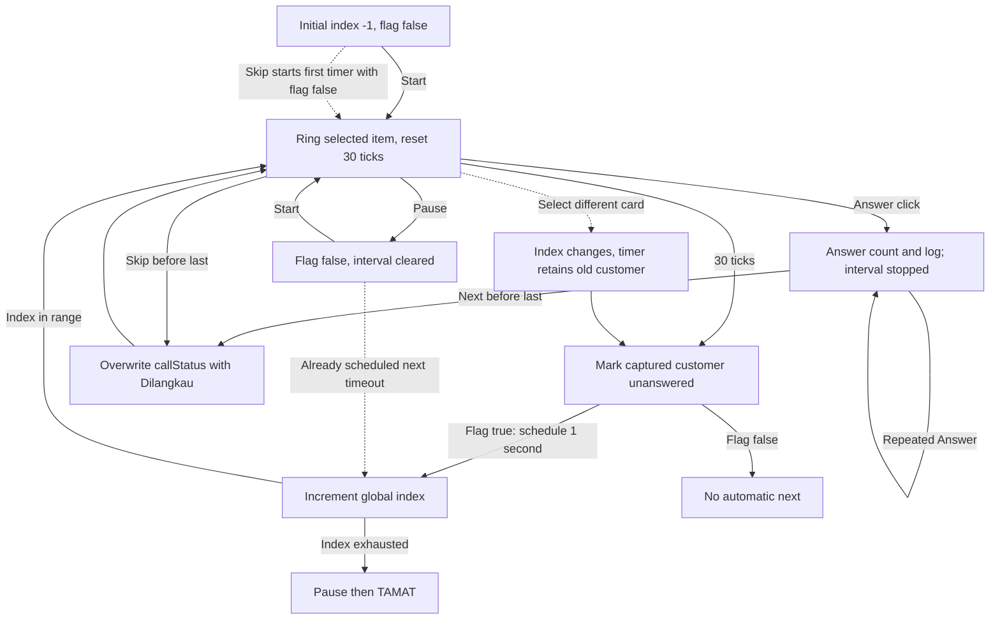
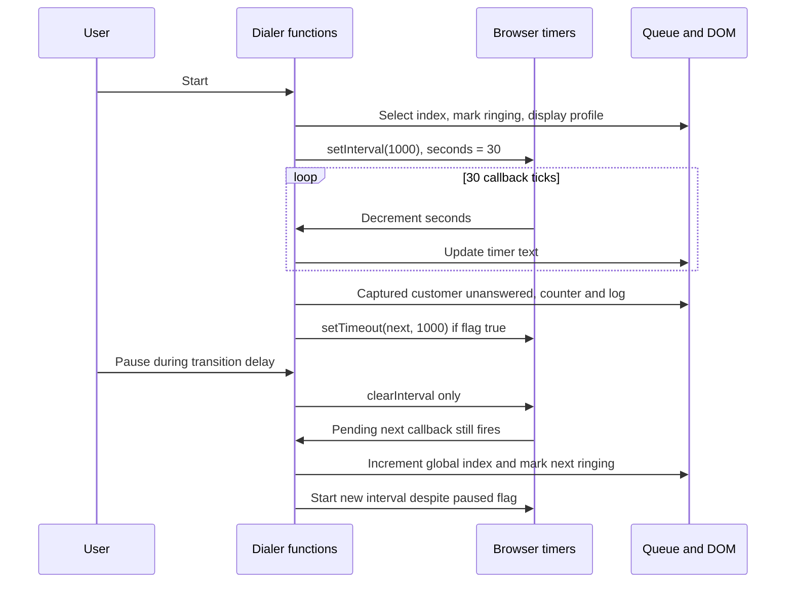
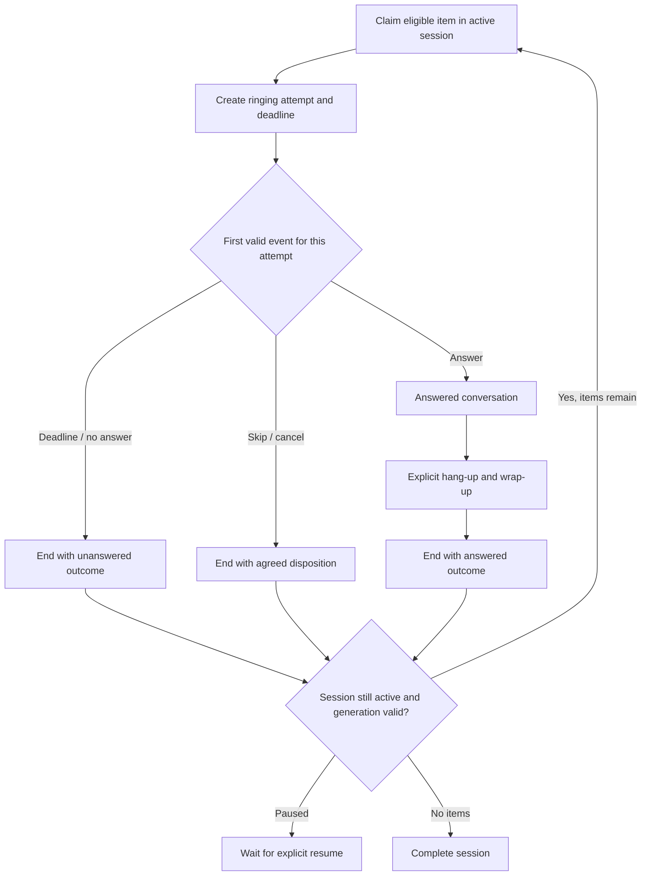

# Current application implementation — 15 November 2026

MySQL 8.4 is final. [database.md](database.md) describes the current schema and scope. The original HTML analysis below documents prototype behavior; its simulated workflows are not descriptions of the new Laravel backend.

**Implemented:** prototype-style English black-and-gold sidebar, header, responsive panels and tables; company-owned customer create/search/edit/archive with encrypted and masked IC, primary installation and current lead outcome; assigned follow-up tasks with status/version checks; organisation product catalog; actual branch dashboard counts; branch member directory; filtered customer CSV reporting and audited export. All CRM routes require login, verified email, active branch membership, organisation-aware Spatie permissions and TOTP enrollment for administrative roles. Branch selection is validated server-side. Roles cannot bypass explicit membership. Customer/Task policies and scoped service/query paths enforce access; FK constraints preserve tenant relationships.

**Workflow:** Fortify sign-in → administrative TOTP challenge (if enrolled) / security enrollment (if missing) → server-resolved branch → MySQL dashboard → customer create/edit → lead and installation save in one transaction → task assignment to active member → progress/completion → dashboard reminder table and filtered CSV. Stale writes return a form error. Archiving preserves history and is refused for outstanding tasks. All data on the implemented screens comes from MySQL. IC input is optional Malaysian 12-digit format pending broader identity policy.

**Pending integration:** Asterisk/SIP.js/Reverb, actual auto/manual calls, call timers/recordings/events, WhatsApp template administration and audited handoff, automated reminder delivery, agent invitations/profile editing, assignment history, historical remarks, sales/orders, PDF/stored exports, broader HQ reporting, editable system settings, production monitoring/deployment. The three-column Auto Dialing workspace displays actual profiles/catalog and clearly states telephony is not connected; it has no fake call controls. Agent directory is read-only; settings display real configuration/integration availability. Neither module is represented as fully complete.

The prototype reference determines visual layout and palette (#101010/#181818/#202020/#D4AF37/#F4DF8A). Existing login is retained. Role-aware navigation and accessible empty/loading/error states are allowed improvements. See DEVELOPMENT.md for test results and exact operational instructions.

---

# SKYBOUND HQ — Workflows and business logic

## 1. Scope and evidence

This is a source-based behavioral reference for `skybound_hq_auto_dialing_prototype.html` (1,456 lines), analyzed on 12 November 2026 in Asia/Kuala_Lumpur. [database.md](database.md) defines existing data and the **Proposed** production schema. [module.md](module.md) inventories the UI and every named JavaScript function. The source remains unchanged.

**Implemented** means an actual browser action; **Simulated** means demo behavior or an incomplete/inert feature; **Proposed** means future implementation; **Requires Clarification** marks unresolved policy. A functioning timer, file download, or external link does not imply a telephone connection, message delivery, database, or access control.

Method: read the complete HTML, trace inline handlers and runtime function replacement, inspect all IDs/data/constants, and execute the application script in a Node VM with a minimal DOM and controlled timers for selected edge cases. The VM checks verify logic, not browser appearance, real network behavior, downloads, telephony, or WhatsApp delivery. No live customers were called or messaged.

## 2. Purpose, journey, and roles

SKYBOUND HQ presents a Malay-language calling and CRM command centre: organize customer leads, work through a calling list, inspect customer installations, recommend a product, prepare a WhatsApp follow-up, and review work. Its working core is a single-document demo, with most data rendered statically or kept in memory.

### 2.1 Current user journey

1. **Trigger:** open the HTML in a browser. There is no login or session check. The visible identity is always “SKYBOUND HQ Admin”, “Admin demo (Ejen #102)”. “Line Telefon: Bersedia” and “Sistem Aktif” are decorative status claims.
2. **Implemented:** on window load, render the 15-item queue, calculate its four statistics, and select the water category. That category operation also replaces the initial message with a generic `Tuan/Puan` product recommendation.
3. Dashboard is visible by default. Seven navigation buttons call `switchPage(pageId)`, hide other pages, reveal the target page, and change the header/nav classes. Navigation does not reload data or stop calls.
4. The user can inspect static reminders, open Auto Dialing, select customers, run the simulated timer, simulate an answer, edit the visible profile, choose catalog models, and launch WhatsApp links. Reporting exports the current queue snapshot.
5. Changes remain in this document's memory or DOM only. A page reload reinitializes everything; a browser close ends the demo. No logout button, logout handler, revocation, or durable save exists.

### 2.2 Proposed authorized journey



**Proposed:** Admin manages users/access/settings; Manager assigns leads and supervises permitted agents; Agent works assigned leads and tasks. Template edit rights can be separately granted. The “Manager / Editor” tag is **Simulated** and all pages are accessible to everyone. **Requires Clarification:** whether Editor is a role or a permission, manager scope, export permission, reassignment rights, and agent visibility of identity data. Do not infer authorization from a visible badge or disabled button.

## 3. Overall data movement



Dashed links are incomplete/disconnected, not database joins. Customer Database → Queue is not an import: a shortcut finds an existing queue object by name or simply opens Auto Dialing. Call Result → Profile exists through display and last-call status, but no attempt history object exists. Product → WhatsApp exists as generated text, not a saved recommendation. WhatsApp → Follow-up is absent. Reports read queue fields, excluding remarks, log rows, reminder dates, product choices and agent ownership.

**Proposed end-to-end transaction boundaries:** `customers` → `leads` + `lead_assignments` → `call_queue_items` → `call_attempts` / `call_events` → `customer_remarks` + `lead_status_events` → `product_recommendations` → `whatsapp_messages` → `tasks` / `reminders` → derived reports. These names match database.md; no such rows exist today.

## 4. Customer lifecycle and lead assignment

### 4.1 Current database interactions

| Trigger | Inputs / condition | Processing and output | State effect |
|---|---|---|---|
| Search name / IC | Free text | Input accepts text; no handler | None; rows do not filter. **Simulated** search. |
| `+ Tambah Pelanggan` | Click | No handler/form | No customer is created. |
| Row action select | Berminat / Call Back / Follow Up / Tidak Berminat | Browser changes selection, `showToast` claims update | DOM only; `queue` and exports unchanged. |
| Call now | Hardcoded name | `quickCallCustomer` looks up queue by exact name, sets index and profile if found, then navigates | No call starts; no log or counter. If no match, navigation and informational toast only; prior selection remains. |
| Row WhatsApp | Hardcoded name and phone | Digit strip, encode shared message, open wa.me | No selected-index change, task, message record or log. |

Shortcut inconsistencies (HTML 299–316, 704–732):

| Displayed row | Call target | WhatsApp target | Consequence |
|---|---|---|---|
| Dashboard Layla | Senah binti Kasim (not in queue) | 60179876543 for Senah | Does not open Layla; WhatsApp destination does not correspond to displayed reminder. |
| Dashboard Aminah Jaya | Miya | 60198765432 | Opens queue Miya instead of displayed customer. |
| Database Zilong | Queue Zilong | 60123456789 | Queue Zilong's phone is +6013-445 5667; direct dialer WhatsApp and row shortcut differ. |
| Database Lunox | Miya | 60198765432 for Miya | Static customer and shortcut identity differ. |
| Database Valir | Valir (not in queue) | 601122334455 | Profile does not switch; old current customer can remain selected. |

No assignment UI, assignment algorithm, agent ownership field, campaign definition, lead import, deduplication, conversion, close action, or customer deletion exists. The Tugasan subtitle promises task distribution, but its page contains product/template controls instead.

### 4.2 Proposed lifecycle and assignment

1. Authorized staff creates/imports a `customers` identity record after phone/IC/deduplication review. Keep installed products in `customer_products` and legacy HP CODE uninterpreted until reconciled.
2. Create a `leads` case with `action_status=pending`; optionally set an installation/package-change `service_intent`. Select an active agent under the actor's scope.
3. In one transaction, set `owner_agent_id`, append `lead_assignments`, and audit the assignment. A task assignee can differ from lead owner only under an explicit policy.
4. Add eligible leads to an ordered `call_queues` batch. Reject or explicitly manage duplicate memberships and competing active claims.
5. Record distinct call attempts and notes. A call being answered does not automatically mean interested or closed. Update lead action separately.
6. Create callback/follow-up work with an explicit date/time and assignee. Recommendation and message handoff may accompany it, without implying a sale.
7. Close a case only through an agreed completion definition; retain historical actor/owner/result facts for reports. Reassignment closes the old ownership interval and does not rewrite history.

**Requires Clarification:** how many active cases a customer may have, distribution method (manual/round-robin/etc.), campaign eligibility, retry interval, ownership scope, and close criteria. None can be reverse engineered from decorative totals.

## 5. Auto Dialing: exact implemented algorithm

### 5.1 State is split and can contradict itself

`isDialing` is an auto-advance flag; `currentIndex` is both manual selection and call position; `countdownTimer` holds only an interval; each timeout closure captures a `currentCust` object. There is no explicit call session or attempt. Button states, global badge, counters, queue statuses, and timer are separately mutated DOM/state and can disagree.

### 5.2 Start and ring

**Trigger:** Mula Auto Call → `startAutoDialing()` (963–985).

1. If queue is empty, show an error toast and return. If `isDialing` is already true, return silently.
2. Set `isDialing=true`, disable Start, enable Pause, and set badge `PANGGILAN AKTIF`.
3. If index is `-1` or beyond the queue, set index to 0; otherwise reuse selected index, including an answered/failed item.
4. Call `dialCustomer(currentIndex)`. It sets the customer's `callStatus='Sedang dipanggil...'`, re-renders the list and displays full customer details immediately. The UI text suggesting details appear only after answer is incomplete: starting a ring also displays them.
5. Clear the previous interval, set `timerSeconds=30`, show `30s`, and create a 1,000ms interval. Each callback decrements by one and updates text. This is 30 callback ticks, not a reliable wall-clock deadline; background-tab throttling can delay it.
6. There is no telephony invocation, media connection, ring detection, random answer, or external event. A separate human click is the only answer simulation.

### 5.3 No answer and automatic next

**Trigger:** the interval reaches zero → `handleUnansweredCall(capturedCustomer)` (1035–1050).

1. Clear interval in the interval callback; mark captured object `Tidak dijawab (Timeout 30s)`.
2. Increment `unansweredCount`; prepend a log row `Tidak Dijawab` / `Tamat masa 30 saat secara automatik`; refresh counters; show warning toast.
3. The function itself does not re-render the queue. Timeout badge changes become visible when the next customer renders; if no advance occurs, the displayed card can be stale.
4. If `isDialing` is true at this instant, schedule a separate one-second timeout. Its callback increments the **then-current global** index and calls `dialCustomer`. No timeout handle is retained, no flag is checked inside that callback, and no generation token exists.
5. At queue exhaustion, `dialCustomer(index >= queue.length)` calls Pause, changes badge to `TAMAT`, and shows completion toast. No profile clearing or new durable completion record occurs. Completion is based on index, not actual item outcomes; skipped/unprocessed items can remain.

Nominal no-answer cycle is about 31 callback-seconds per customer (30 ticks + one-second transition). Last customer also waits the transition second before reaching `TAMAT`.

### 5.4 Answer simulation

**Trigger:** Simulasi Customer Jawab → `simulateCustomerAnswer()` (1053–1070).

- Only guard: index must be in range. Starting a call is not required if a customer has been selected manually.
- Clear interval; set selected customer's status to `DIJAWAB (Panggilan Aktif)`; increment answered counter; display profile and render queue; update counters and prepend a `DIJAWAB` log row.
- Keep `isDialing` and Start/Pause button state unchanged. No conversation-duration timer, hang-up, automatic next, save requirement, or terminal answered state exists.
- Repeated clicks increment the same customer's answer count repeatedly. Answering after a timeout can yield both answered and unanswered counts. A pending next timeout is not cancelled.

### 5.5 Pause and restart

**Trigger:** Pause → `pauseAutoDialing()` (987–1000).

- Set `isDialing=false`, clear interval, enable Start, disable Pause, set badge `PAUSED`, and show toast.
- Do not change selected customer's call status, displayed details, timer value, or logs; there is no actual phone call to suspend.
- Start after Pause calls `dialCustomer` on the same index and resets to a full 30 seconds. It does not resume remaining seconds or skip completed items.
- A next-customer timeout scheduled before Pause still fires and creates a new interval while `isDialing=false`. This race was confirmed with controlled timers.

### 5.6 Skip / Proceed Next Call

Both controls call the same `skipNextCall()` (1072–1083), with no implicit Save.

1. If `currentIndex < queue.length - 1`, clear interval and set current object's `callStatus='Dilangkau'` if it exists.
2. Increment index and immediately call `dialCustomer`, even when paused or never started. At initial `-1`, Skip starts the first customer's timer while `isDialing=false`; its timeout increments unanswered but does not schedule a further customer.
3. No skip log row, skipped counter, or statistics update occurs. An answered call's status can be overwritten to skipped while its answer counter/log remain.
4. On the last item, show “end of list” toast only. It does not clear a running interval or complete an answered final call. An unanswered last item can still time out normally; an answered last item can remain stuck with active badge/flag until Pause.

### 5.7 Manual selection and cross-module shortcuts

Clicking a queue card sets `currentIndex`, displays customer, and renders list; it neither stops nor rebinds an existing interval. `quickCallCustomer` also changes index and details without clearing timers, and does not re-render queue immediately. The timeout closure may still mark customer A unanswered after the user selects B; the scheduled transition increments B's index, potentially bypassing B or other items. WhatsApp and Save use selected index B. This is a customer identity integrity issue, not only a visual inconsistency.

### 5.8 Current transition diagram

The nodes below are explanatory behavioral states, not enums declared by the source. Dashed transitions identify surprising paths.





### 5.9 Statistics and log semantics

`total=queue.length`; `answered=answeredCount`; `unanswered=unansweredCount`; `remaining=max(0, total-(answered+unanswered))`. Remaining does not count queue dispositions; skips do not decrease it and duplicate answers can reduce it to zero before all customers are processed. Counts can exceed 15. It is not an agent performance report.

`addCallLog` removes the italic placeholder on first insert, builds HTML with time/name/phone/status/remark, and prepends rows. Time uses the browser locale/timezone with seconds, not an explicit Malaysian timezone or full timestamp. Skips, Pause, profile saves, quick WhatsApp, resets and manual selections do not create logs. The direct WhatsApp button does create a claimed-sent row, although delivery is unobserved. Reset does not clear rows.

### 5.10 Proposed reliable dialer

Use the `call_queues`, `call_queue_items`, `dialer_sessions`, `call_attempts`, and `call_events` schema in database.md. Keep `selectedCustomerId` separate from `activeAttemptId`. Backend/provider attempt identity owns transitions. A ring deadline is an instant, not a count of browser ticks. Pause/cancel increments a session generation and cancels pending jobs; every worker callback checks session state and generation atomically before claiming next work.



**Requires Clarification:** whether Pause terminates a ringing/answered provider call or merely stops future calls; whether Skip during a conversation means cancel/hang-up or complete; retries and busy/failed/invalid-number outcomes; wrap-up requirements. Do not assume those semantics from the current demo.

## 6. Profile editing, remarks, and Save

**Trigger:** queue selection, ring start, answer or matching shortcut populates profile through `showCustomerDetails` (1133–1149). It copies name, phone, IC, existing product, address, install/expiry strings and status. It reveals action buttons and sets `MAKLUMAT AKTIF`; this badge is not call evidence.

| Editable field / action | Actual behavior |
|---|---|
| IC, existing product, address, install, expiry | Browser accepts edits; effective Save ignores them. Changing customer repopulates original values. |
| Contract select (7/5/3 years) | No ID, no state mapping, no read/write code; persists as unrelated DOM selection across customers. |
| Status select | Only Pemasangan Produk / Berminat Follow-up / Tukar Pakej / Tidak Berminat. Other seeded statuses yield empty selection. Effective Save can write empty status. |
| Remark input | Shared DOM value, initialized to a sample interest remark; not loaded or cleared per customer. Save writes that value to selected queue customer. Cross-customer carry-over is possible. |
| 12 Bulan / 6 Bulan / 1 Bulan quick remarks | Replace text with “Cust minta call semula bulan depan”, “Cust tunggu budget bonus”, “Tukar filter baharu” respectively. No calendar calculation; 12-month label contradicts “next month” text. |
| Save | Runtime override writes status, remark, reminderDate and whatsAppDate; renders queue and shows success. No persistence or log; no auto-next. |
| Proceed Next Call | Calls Skip; unsaved inputs are not saved first. |

The original `saveCustomerProfile` (1163–1169) writes status and address. At 1439–1451 its reference is saved as `skyOriginalSaveCustomerProfile` and the function is replaced. For a valid selected customer the new branch never calls the original, so address saving is lost. With no selected customer it calls the original, which does nothing. This is the behavior developers must use, not the earlier comment or function body in isolation.

`cust-action-status`, `cust-reminder-date`, `cust-wa-date`, and `.lead-action` have no elements in the provided UI. Consequently Save uses the legacy select and writes both date properties as empty strings. `setLeadAction` is defined but never bound or called by the source; `currentLeadAction` does not affect Save. If integrated later, the helper defaults interested/callback/follow-up reminders to tomorrow using UTC ISO date formatting after local date arithmetic, and clears the reminder for not-interested. That latent code is not a working reminder workflow.

**Proposed save:** submit explicit customer/lead IDs and version; validate changed fields and status dimension; authorize; atomically update master fields, lead action/status history, append remark, and create/update task/reminder only when requested; return saved values. Bind forms per record, warn or resolve unsaved edits on selection, and report failure honestly. Separate installation intent from lead action rather than enlarging one ambiguous status enum.

## 7. Follow-up and reminders

**Current:** dashboard reminders are two static rows dated 28 and 29 October 2026. Neither date is evaluated for overdue status. Quick remarks alter text only; Save has no usable date controls; no scheduling worker, alerts, follow-up task list, WhatsApp due execution, notification centre, recurrence, task completion or reminder-to-dashboard propagation exists.

**Proposed:** selecting callback/follow_up creates or updates an assigned `tasks` row with explicit due date or scheduled instant and timezone. A worker claims pending `reminders`, verifies task still open and assignment still valid, creates a notification or sends an agreed channel, and records outcome with idempotency. Completing/rescheduling/cancelling the task invalidates obsolete reminders. Dashboard queries actual upcoming/overdue work, and shortcuts use immutable customer/lead IDs.

**Requires Clarification:** whether interested requires a reminder, how the month buttons map to dates, reminder recipients/channels and times, weekend handling, recurrence/escalation, date in the past, relationship of WhatsApp date to call date, and whether not-interested suppresses future contact.

## 8. Product recommendation and catalog editing

### 8.1 Auto Dialing product selection

1. Category button calls `selectCategory(water|air|ac|mattress)`, resets button styles, rebuilds the model select from `productsData`, and selects the first model through normal browser behavior.
2. It calls `onModelChange`, which finds the selected product or falls back to the first model of the current category.
3. Populate remote image, name, monthly price display and description; replace the entire message textarea with a product promotion greeting the **current selected** customer, or Tuan/Puan if none.
4. No recommendation, customer-product link, lead update or sale is saved. Switching category/model discards manual message edits without warning. Merely changing customer does not regenerate the message, so customer name can remain generic or refer to a previous customer.

### 8.2 Tugasan product save

**Trigger:** Simpan Produk Demo → `saveTaskProduct` (1359–1368). Trim name/price; reject blank name; append a name-valued `<option>` to the Auto Dialing model select and toast that backend is not connected. It does not read `task-product-category`, add a model to `productsData`, use a description, select the newly added option, or update the preview.

Selecting that appended name later cannot find an ID match; `onModelChange` falls back to the first existing model in the active category. Changing category rebuilds the select and drops the appended option. This is **Simulated** catalog editing even though DOM appending is **Implemented**.

**Proposed:** validate category/model code, money/currency, description and image; persist `product_models`; refresh catalog from saved response; record recommendation snapshots when explicitly offered. Do not conflate an existing installation with a recommended replacement.

## 9. WhatsApp content, permissions, and handoff

### 9.1 Template selection and editing

`whatsapp-template` offers manager/custom1/custom2. `applyWhatsAppTemplate` uses the current `manager-wa-template` textarea for manager, falling back to the object only if the element is absent; custom options use fixed object strings. Thus typing in Manager/Editor page affects template selection without pressing Save. The shared message textarea remains editable to all users.

`saveWhatsAppPermissions` parses a nonnegative numeric limit, reads selected agent names, and **first** assigns manager content to `customWhatsAppTemplates.manager`. It then rejects if selected count exceeds limit, otherwise shows a success toast. Grants and limit are not persisted/enforced. Invalid numeric input, fractional limits and business quota semantics are not validated beyond the local count check/HTML min. Failed validation can still change manager template content; a disabled-permission demo has no security effect.

### 9.2 Direct Auto Dialing WhatsApp

1. Trigger `sendDirectWhatsApp` reads `queue[currentIndex]` and the shared message.
2. If no selected customer or no truthy phone, show warning and return.
3. Strip all non-digits, URI-encode message, open `https://wa.me/<digits>?text=<encoded>` in a new tab/window.
4. Show success toast and append `WhatsApp Dihantar` / “Promosi produk telah dihantar ke WhatsApp” to DOM call log regardless of window-open result or actual Send action.
5. No API call, webhook, message ID, delivery status, permission/consent check, phone-country normalization, follow-up date update or body validation occurs. A truthy phone containing no digits can produce an invalid destination.

### 9.3 Quick row WhatsApp

`quickWhatsAppCustomer(name, phone)` uses the supplied hardcoded destination, rejects an empty digit string, uses current message or manager object fallback if empty, and opens the same link. It explicitly tells the user to review and press Send in WhatsApp. No call log is added and selected customer remains unchanged. Shared text may describe a different person/product from the destination.

```mermaid
sequenceDiagram
    participant U as User
    participant UI as Prototype
    participant W as External WhatsApp
    U->>UI: Choose model or template; optionally edit message
    UI->>UI: Update shared textarea only
    U->>UI: Hantar Terus Ke WhatsApp
    UI->>UI: Read selected queue customer and strip phone
    UI->>W: Open wa.me URL with encoded text
    UI->>UI: Claim sent in DOM log without confirmation
    Note over W: User may review and manually Send
    Note over UI,W: No callback or delivery evidence returns
```

**Proposed:** snapshot customer ID, recipient, content, template version and recommendation before handoff; label link opening as `handoff_requested` / `handoff_opened`, not sent. For a future provider API, validate permissions and contact eligibility server-side, enqueue idempotently, and record actual provider acceptance/delivery events. **Requires Clarification:** manual-link versus provider API target, custom-template ownership, agent-edit quota scope, approval process and retention.

## 10. Agent management

Static cards: Zilong (AGENT-01, 45 leads, 12 interested/8 follow-up), Fanny (AGENT-02, 38, 9/11), Layla (AGENT-03, 52, 15/6), Minotaur (AGENT-04, 29, 7/5). These are fixtures, not aggregates.

1. Edit Ejen passes the clicked button to `openAgentEditor`. It finds closest `.p-4` card, scrapes name/code/phone text, and interpolates a modal into `sky-modal-root` with name, code, phone, image file and demo reset-password fields. No agent ID is carried.
2. File selection calls `previewAgentPhoto`: FileReader produces a local data URL and sets preview/draft. `accept=image/*` is a chooser hint, not content/size validation. No upload occurs.
3. Save requires a trimmed nonempty name; locate original card by original name (`defaultValue`), replace title, optionally replace image, and update matching code/phone text lines.
4. Close modal and toast success even if matching card cannot be found. Duplicate names can select wrong card. Password input is never read. Report/template dropdown names and other statistics do not update.
5. Cancel, ×, or clicking backdrop closes without saving the modal. No Escape handling, focus trap, server validation or audit exists. Create and Padam buttons are inert.

**Proposed:** use immutable `agents.id` and `users.id`, authorized profile update with unique agent code and version checks; validate/uploads images; make password reset an independent secure token workflow; deactivate agents while preserving historical assignments. Decide reassignment of active leads/tasks before deactivation. Reports derive counts using acting-agent and ownership-time policies, never scraped card labels.

## 11. Reports and exports

### 11.1 CSV

`exportReportCSV(agentOnly=false)` reads `report-agent-filter` as a heading string, builds title/scope/ejen metadata rows and header `Nama Customer, Telefon, Status, Catatan`, then emits **every queue customer** with `name`, `phone`, `status`, `callStatus || 'Belum dihubungi'`. “Catatan” contains last call status, not the saved remark. `agentOnly=true` changes scope metadata to Prestasi Ejen; row shape/data stay identical.

Fields are double-quoted, embedded quotes doubled, rows CRLF-joined, UTF-8 BOM prepended, then Blob/object URL and a temporary anchor trigger `skybound-hq-laporan.csv`; URL is revoked. This is a CSV file, not XLSX. No assignments, dates, tasks, aggregate statistics or chart data are included despite card descriptions. Agent filter does not filter rows; date inputs are never read. Spreadsheet formula prefixes are not neutralized.

### 11.2 Print/PDF

`exportReportPDF` builds an HTML table of all queue names/phones/statuses/call statuses, opens a blank window, writes inline CSS/document and a print-on-load script, then closes the document. Header includes selected agent text and current date formatted `ms-MY` in the browser timezone. A blocked popup causes warning and return. Browser print UI may allow Save as PDF; no PDF bytes/download or chart generation exists.

**Proposed:** authorize scope; validate from <= to; use explicit report timezone and event-date definition; filter actual records by acting agent or agreed historical ownership; return stated columns and derived aggregates; escape print HTML and mitigate CSV formulas; report empty results accurately. Track export actor/filter/row-count if audit is required. **Requires Clarification:** task versus attempt versus lead report granularity, date basis, attribution after reassignment, completion denominator, retention and masking of sensitive fields.

## 12. Settings, reset, and feedback

Timeout “30 Saat” is a static label; `dialCustomer` hardcodes 30. WhatsApp Gateway “Aktif” is a static label; only wa.me navigation exists. Neither is a configurable setting.

`resetDemoData` deep-clones initial customers, resets index and `isDialing`, clears interval, zeros answered/unanswered counters, renders queue/stats, hides customer details/actions and shows toast. It does **not**:

- Cancel the separate pending next timeout; a stale callback can restart the new queue at index 0.
- Restore timerSeconds/text, Start/Pause disabled/styles, global badge, customer active badge, log rows, remarks, contract select, model selection, appended model options, template edits/permissions DOM, agent edits, filters, or photo draft.

Reset during active dialing can leave Start disabled and Pause enabled. Selecting Pause afterwards may restore Start; reload fully initializes the document. Reset is neither a full session reset nor an audit-preserving production operation.

`showToast` writes text safely via `innerText`, chooses success/warning/error/info icon, reveals one shared toast, and schedules hide after three seconds. Old hide timeouts can hide a newer toast early. Notifications are not queued or durable and are not an audit trail.

## 13. Cross-validation, edge cases, and acceptance foundation

| Finding | Evidence / verification | Impact and proposed resolution |
|---|---|---|
| Answer counted twice | VM: Start; Answer; Answer => answeredCount 2 for one item | Distinct attempt ID and idempotent result transition. |
| Pause race | VM: 30 ticks; Pause; run pending one-second callback => next timer active with flag false | Cancel scheduled work and verify session generation on execution. |
| Skip before Start | VM: Skip from -1 => index 0 and active interval with flag false | Explicit state-machine guard; selection and dialing independent. |
| Save loses address and status | VM with select semantics: initial Pending has no option; edit address; Save leaves address and writes blank status | Field mapping test, separate status taxonomy, remove conflicting override in future implementation. |
| Reset leaves Start disabled | VM: Start; Reset => Start still disabled, index -1 | Central reset/state rendering and cancellation of all timers. |
| Missing reminder controls | Source ID inventory: references exist only in helpers/override | Implement explicit follow-up UI/workflow or remove claims; do not assert existing scheduling. |
| Selection races | Source: interval captures currentCust but next increments global index | Capture immutable attempt/item identity and isolate selected record. |
| Wrong-customer shortcuts | Static row labels versus handler arguments | Bind actions to IDs and show/confirm correct recipient context. |
| Stale shared remark/message | Profile renderer never restores remark or regenerates message | Per-record form state and explicit message preview/recipient binding. |
| Misleading filtered reports | Exports iterate all queue; dates unused | Scope query on backend and test known agent/date exclusions. |
| Untrusted HTML / CSV | String interpolation into innerHTML/document.write; quoted CSV only | Contextual encoding, safe DOM, input controls and formula neutralization. |

A future production acceptance suite should exercise the same scenarios plus late provider callbacks, duplicate events, multi-tab/concurrent claims, reassignment while dialing, missing phone, empty queues, last-item answer/skip, paused resume, unsaved form changes, rejected template grants without partial write, unauthorized exports, out-of-range dates, failed image uploads, blocked popups, notification retries and clock/timezone boundaries. This is a proposed test foundation, not a claim those checks pass today.

The current source has no network error handling for CDN/avatar/product image failures, no persistence recovery, and no server authorization. Invalid internal page IDs can hide all pages then throw on a missing element, although normal navigation passes known IDs. Unsupported source shapes such as missing `callStatus` break `.includes`; fixed seeds happen to satisfy that expectation. These are implementation preconditions, not validated input contracts.

