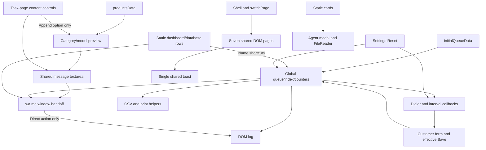
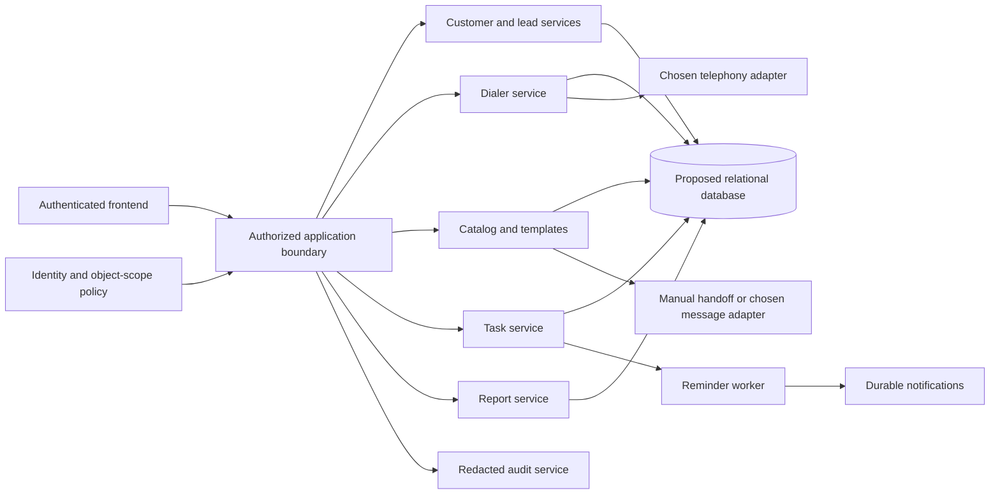

# Current application implementation — 15 November 2026

MySQL 8.4 is final. [database.md](database.md) describes the current schema and scope. The original HTML analysis below documents prototype behavior; its simulated workflows are not descriptions of the new Laravel backend.

**Implemented:** prototype-style English black-and-gold sidebar, header, responsive panels and tables; company-owned customer create/search/edit/archive with encrypted and masked IC, primary installation and current lead outcome; assigned follow-up tasks with status/version checks; organisation product catalog; actual branch dashboard counts; branch member directory; filtered customer CSV reporting and audited export. All CRM routes require login, verified email, active branch membership, organisation-aware Spatie permissions and TOTP enrollment for administrative roles. Branch selection is validated server-side. Roles cannot bypass explicit membership. Customer/Task policies and scoped service/query paths enforce access; FK constraints preserve tenant relationships.

**Workflow:** Fortify sign-in → administrative TOTP challenge (if enrolled) / security enrollment (if missing) → server-resolved branch → MySQL dashboard → customer create/edit → lead and installation save in one transaction → task assignment to active member → progress/completion → dashboard reminder table and filtered CSV. Stale writes return a form error. Archiving preserves history and is refused for outstanding tasks. All data on the implemented screens comes from MySQL. IC input is optional Malaysian 12-digit format pending broader identity policy.

**Pending integration:** Asterisk/SIP.js/Reverb, actual auto/manual calls, call timers/recordings/events, WhatsApp template administration and audited handoff, automated reminder delivery, agent invitations/profile editing, assignment history, historical remarks, sales/orders, PDF/stored exports, broader HQ reporting, editable system settings, production monitoring/deployment. The three-column Auto Dialing workspace displays actual profiles/catalog and clearly states telephony is not connected; it has no fake call controls. Agent directory is read-only; settings display real configuration/integration availability. Neither module is represented as fully complete.

The prototype reference determines visual layout and palette (#101010/#181818/#202020/#D4AF37/#F4DF8A). Existing login is retained. Role-aware navigation and accessible empty/loading/error states are allowed improvements. See DEVELOPMENT.md for test results and exact operational instructions.

---

# SKYBOUND HQ — Module architecture and source reference

## 1. Scope, status vocabulary, and architecture

This reference covers the complete available project: `skybound_hq_auto_dialing_prototype.html`, a 1,456-line single-file Malay-language CRM/calling prototype. Analysis date: 12 November 2026, Asia/Kuala_Lumpur. [database.md](database.md) contains the data dictionary, proposed production tables, constraints and ERD. [flow.md](flow.md) contains exact workflows, timer transitions and failure scenarios. No source changes or new application features accompany these documents.

**Implemented** identifies code-backed browser behavior. **Simulated** identifies fixtures, cosmetic/incomplete actions or operations claiming an unverified effect. **Proposed** identifies future architecture or capability. **Requires Clarification** identifies business decisions the source cannot settle. Features can contain both implemented mechanics and simulated business effects: wa.me opening is implemented; delivery reporting is simulated.

Evidence: full HTML review, inline handler/ID/function inventories, dependency tracing, runtime save replacement review, source hashing, and controlled Node VM execution of selected dialer/profile/reset scenarios. This is not a browser visual QA, real gateway integration test or security certification. No server, database, manifests, PPT, other project assets or tests were present in the initial root directory.

### 1.1 Business intent

SKYBOUND HQ is intended to centralize lead calling, customer/installation details, agent work, product promotion and follow-up. The primary workspace is a three-column Auto Dialing screen: queue and timer; customer profile and remarks; catalog and WhatsApp editor. Dashboard, customer rows, agent cards and report cards frame that workspace but do not form a connected CRM data model today.

### 1.2 Current technical components

| Layer | Source and responsibility | Current boundary |
|---|---|---|
| Presentation shell | Head/theme 1–97; sidebar/header 102–198; main viewport 199–855 | One DOM; Tailwind utilities and custom black/gold overrides. |
| Seven page containers | `page-dashboard`, `page-autodial`, `page-tugasan`, `page-database`, `page-ejen`, `page-laporan`, `page-tetapan` | CSS `hidden` switching, not routes or independent screens. |
| Data constants | 876–892, 904–923, 1312–1316 | Seed customers, fixed catalog, three text templates. |
| Global state/controller | 894–901 and functions 932 onward | No store, services, dependency injection, reactive binding or domain classes. |
| DOM event handlers | Inline onclick/onchange; dynamically assigned queue `.onclick`; `window.onload` | UI tightly coupled to global functions and hardcoded IDs. |
| Browser side effects | Timers, FileReader, Blob/object URLs, window.open, print | Local simulation and external handoff; no application API. |
| Overlay/feedback | `sky-modal-root`, `toast-container`; 1286–1307 and 1379–1419 | One modal host and one shared toast; no durable notifications. |

Scripts run in order: Tailwind CDN, inline Tailwind config, then bottom application script. Bottom script declares core functions and initialization, then enhancements replace `saveCustomerProfile`. `window.onload` runs after resource loading; it renders queue/stats and selects water. Initial dashboard counts and reminder rows remain static.

### 1.3 External dependencies and claims

| External/browser dependency | Actual use | Failure / production consideration |
|---|---|---|
| `cdn.tailwindcss.com` | Styling runtime and `tailwind.config` | Network/script failure can lose styling; config assumes `tailwind` exists. No pinned build pipeline. |
| cdnjs Font Awesome 6.4.0 | Icon stylesheet/assets | Icons may fail externally; no local fallback. |
| Google Fonts Inter | Typography | Depends on external font resources; sans fallback exists. |
| DiceBear 9.x | Admin initials and agent/demo modal avatars | No real user photo store; remote availability/privacy dependency. |
| placehold.co | Product preview images | Placeholder art, not local product media; no image-error handler. |
| `wa.me` | New window with phone/message query | Manual WhatsApp handoff, no authenticated API, callbacks or delivery proof. |
| Browser APIs | setInterval/setTimeout, FileReader, Date, Blob, URL, print | Background throttling, file limits, popup policy, download/print UX and client timezone apply. |

“Line Telefon: Bersedia”, “Sistem Aktif”, version “v2.4 Pro”, and WhatsApp Gateway “Aktif” are **Simulated** labels. No SIP/WebRTC/PSTN/tel link, telephone SDK, media connection, webhook, authentication endpoint, database client or WhatsApp Business API occurs. This conclusion concerns supplied source only; it does not establish what might exist elsewhere outside the repository.

## 2. Dashboard — `dashboard`

**Purpose / responsibilities:** provide an HQ overview, direct users to calling and reports, and expose upcoming customer activities. Source 202–322. Current overall status: **Simulated** dashboard data with **Implemented** navigation and shortcuts.

| UI component / action | Input → processing → output | Functions / entities / status |
|---|---|---|
| Four KPI cards | Fixed totals 248 leads, 76 completed, 8 agents, 32 follow-up; +12 today | No calculation or handler; separate fixtures. |
| Auto Dialing banner | Click → show autodial page | `switchPage('autodial')`; “15 ready” is static copy. |
| Status summary | Fixed 18 sales potential, 24 WhatsApp follow-up, 24 pending feedback, 12 product close | No binding to queue or logs. |
| Full report link | Click → show laporan | `switchPage('laporan')`. |
| Reminder table | Two rows: Layla / Follow-up 3 Bulan / budget note / 28 Oct 2026; Aminah Jaya / Berminat Aircond / discuss with husband / 29 Oct 2026 | Static names, text, dates; no task/reminder entity, sorting, due check or refresh. |
| Each Call now / WhatsApp | Hardcoded handler arguments → name lookup or external link | `quickCallCustomer`, `quickWhatsAppCustomer`; targets disagree with row names, detailed in flow.md. |

Inputs are clicks and constants; outputs are navigation, selected queue profile or external handoff. Existing data is unrelated DOM fixtures and shared queue for successful shortcut matches. **Business rules:** only shortcut helper guards apply; no reminder policy, metrics definition or role restrictions. **Dependencies:** navigation, customer selector, shared WhatsApp textarea/template fallback, browser popup behavior. Changes to queue/statistics do not update this page.

**Proposed role access:** Agent sees assigned work and personal counts; Manager sees agreed team scope; Admin sees authorized aggregate scope. All users currently see the same page. **Missing:** authoritative dashboard query, ownership/due-date filtering, correctly bound customer IDs, live totals, overdue indicators, completion definition, real reminder records and protected PII. **Requires Clarification:** meaning of completed, sales potential, product close, pending feedback and reporting date windows.

## 3. Auto Dialing — `autodial`

**Purpose / responsibilities:** guide sequential outreach, display customer context, capture actions/remarks, choose promotions and hand off a message. Source 325–646. It is the largest implemented interaction surface, but telephone behavior and delivery claims are **Simulated**.

### 3.1 Queue, controls, and statistics

| UI / event | Inputs / processing | Outputs / state / validation |
|---|---|---|
| Four statistics | `queue.length`, incremental counters | total, answered, unanswered, `max(0,total-answered-unanswered)`; skips uncounted, duplicates possible. |
| Queue card click | Card's captured object/index | Change `currentIndex`, display profile, render queue; running timer remains attached to old captured object. |
| Start | Empty queue and `isDialing` guards | Enable flag, button states and badge; `dialCustomer` current index or 0; 30-tick interval. No call sent. |
| Pause | Any current state if invoked | Clear interval and flag, restore buttons, PAUSED badge; pending next timeout survives. |
| Answer simulation | Only in-range index required | Stop interval, set answered string, increment counter, render/display/log; flag unchanged. |
| Skip icon / Proceed Next Call | Index < final item | Mark old item Dilangkau, increment and start timer regardless of flag; no save, log or skip count. Last-item action only toasts. |
| Timer | 30 interval callbacks, then optional one-second delayed next | Timeout mutates captured customer; transition increments global index. No accurate wall-clock deadline. |
| Global/current badges | Ad hoc DOM text/classes | Sedia, PANGGILAN AKTIF, PAUSED, TAMAT; customer badge MAKLUMAT AKTIF does not prove an active call. |

Functions: `startAutoDialing`, `pauseAutoDialing`, `dialCustomer`, `handleUnansweredCall`, `simulateCustomerAnswer`, `skipNextCall`, `renderQueueList`, `highlightCustomer`, `showCustomerDetails`, `updateStats`, `addCallLog`. Inputs are global queue/index/flag plus UI clicks/ticks. Outputs are mutable `callStatus`, counters and DOM rows/cards; no structured attempt/session. All queue entries render on every render call; there is no pagination, retry prioritization, eligibility check, ownership, concurrency protection or agent-specific queue.

Queue badges test `callStatus.includes('DIJAWAB')` and `.includes('Tidak dijawab')`, so string case matters. Active base color is overridden by answered/failed color; selected styling and last-call outcome are separate visual layers. Missing/nonstring callStatus would throw, although supplied seed is valid.

### 3.2 Customer profile and actions

| Component | Input/output and saving behavior |
|---|---|
| Empty state / detail card / action buttons | Initially empty; selection, ring and answer reveal profile and actions. |
| Name and phone | Display text from selected queue object; no edit control. |
| IC, existing product, address, installation, expiry | Populated per customer into editable fields; effective Save ignores all these edits. |
| Status Pilihan | Four options Pemasangan Produk, Berminat Follow-up, Tukar Pakej, Tidak Berminat; unsupported seeded status becomes empty selection. Save writes selected value, even empty. |
| Contract | Unidentified select 7/5/3 years; never loaded from or saved to queue. |
| Quick remark matrix | 12/6/1 Bulan buttons replace shared remark with fixed text; do not calculate dates. |
| Remark | Shared input; not populated/cleared per customer; saved as last remark on selected queue object. |
| Save profile | Effective override writes status/remark and two empty date strings, re-renders queue/toasts; no address or IC update, task creation or storage. |
| Proceed Next Call | Same Skip helper; does not save first. |

Functions: `showCustomerDetails`, `setQuickRemark`, original and overridden `saveCustomerProfile`; unbound `setLeadAction` is not available as a UI control. Related entities are existing customer objects plus **Proposed** customers, customer_products, leads, customer_remarks, tasks and reminders. `cust-action-status`, `cust-reminder-date`, `cust-wa-date` and `.lead-action` references have no matching controls. There is no working follow-up date editor.

**Rules/risks:** no per-field validation; source month strings are free text; Save override bypasses original address save; shared remark/message state can affect another customer; no optimistic concurrency or audit; selection and active call are conflated. Detailed transitions and reproduction steps are in flow.md sections 5–7.

### 3.3 Product and WhatsApp panel

Four category buttons (water/air/ac/mattress) feed one model select and a preview containing image/title/price/description. `selectCategory` rebuilds options from the fixed catalog, then `onModelChange` updates preview and replaces the whole message. The catalog has nine models (database.md section 2.2). Message generation uses current selected customer name only when category/model changes. Changing customer alone does not update message; model changes discard edits.

Template select has manager/custom1/custom2 and calls `applyWhatsAppTemplate`; manager reads live manager-editor textarea, even unsaved. Custom messages are fixed strings, while textarea is freely editable. Direct send invokes `sendDirectWhatsApp`: validate selected customer/phone truthiness, strip digits, encode text, `window.open(wa.me)`, toast success and append a claimed-sent log. Actual review/send is outside this application and unobserved. Nothing records product choice, recommendation, delivery or WhatsApp schedule in queue.

**Dependencies:** fixed catalog, manager-template DOM on another hidden page, selected index, browser resources and external WhatsApp. **Proposed access:** agents may use active catalog and permitted templates on their own assigned leads; manager/editor can administer content; backend enforces separate template grants. Current inputs are unrestricted.

### 3.4 Session log and production requirements

Log table columns: time, customer name, phone, call status, note/WhatsApp. It starts with an italic placeholder, then prepends HTML rows for answer, timeout, or direct WhatsApp. No selected remark is passed to answer/timeout logs; fixed explanatory text is used. There is no log array, IDs, event timestamps with dates, attempt duration, actor or durable history. Reset leaves logs intact.

**Missing / Proposed:** real authorized queue sourcing; immutable customer/attempt IDs; explicit state machine; provider adapter; ring deadline; cancellation of all delayed work; separate browse selection; valid answer/hang-up/wrap-up; idempotent events; per-record form state; typed status dimensions; persistent customer/installation editing; note/task/reminder creation; recommendation and message snapshots; truthful handoff status; durable logs and derived counters. **Requires Clarification:** provider, retry/skip/Pause policies, completion meaning, contact eligibility and wrap-up requirements.

## 4. Pengurusan Tugasan — `tugasan`

**Purpose as titled:** task assignment and agent campaigns (navigation subtitle). **Actual responsibilities:** limited catalog-option demo and manager WhatsApp content/editor-count demo. Source 649–673. No task board/list, assignment form, campaign, assignee selection for work, task status or due date exists.

| UI / action | Inputs → processing → output | Current status |
|---|---|---|
| Manager / Editor badge | Static label | **Simulated** role. |
| Category select | Penapis Air / Penapis Udara / Aircond / Mattress | Value accepted by browser but never read by save helper. |
| Product name and price | Trim name/price; name required | `saveTaskProduct` appends an option to hidden Auto Dialing model select; catalog object unchanged. |
| Product save | Name-valued option, optional price display suffix | Selecting it falls back to first hardcoded model; category switch drops option. **Simulated** catalog CRUD. |
| Manager template textarea | Any text | Shared DOM text directly consumed by template selection; no validation/versioning. |
| Editor limit | Number, min 0, default 2 | Helper Math.max clamps numeric negatives but does not establish integer/quota semantics. |
| Permitted-agent multiselect | Zilong/Fanny/Layla/Minotaur names | Count checked against limit; selected grant list never stored/enforced. |
| Save permissions | Manager content assigned before over-limit check | Success/warning toast; failed quota can still mutate template content. |

Functions: `saveTaskProduct`, `saveWhatsAppPermissions`, with downstream `selectCategory`, `onModelChange`, `applyWhatsAppTemplate`. Inputs/outputs are DOM values/options and one manager string. Existing entities: catalog object, templates object, hardcoded agent options; no tasks. **Proposed entities:** product_categories, product_models, whatsapp_templates, whatsapp_template_versions, whatsapp_template_editors plus separate leads/tasks/assignments services.

**Dependencies:** Auto Dialing DOM model select/message selector and hardcoded agent names; no binding to agent-card edits. **Business rules:** nonblank model name and local count ceiling only; no price validation, model uniqueness, category enforcement, template nonblank rule, authorization or grant persistence.

**Proposed role access:** Manager with catalog/template capability, and specifically granted editors; distinguish using a message from editing its official template. **Missing:** real task management, ownership history, catalog CRUD, durable template/version/grants, atomic quota validation, refresh after save, server permission checks and audit. **Requires Clarification:** whether to split task management and content administration into distinct UI pages, what Editor means, quota per template/team/system, custom-template ownership and campaign scope.

## 5. Database Pelanggan — `database`

**Purpose / responsibility:** intended customer master and installation/contract reference, plus status and outreach shortcuts. Source 676–738. Current main table is **Simulated** static HTML with some **Implemented** shortcuts.

UI components: heading/subtitle, name/IC search input, Add Customer button; table columns HP CODE, name, IC, product, address, status, installation, action status and quick actions. Rows: Zilong (11, Aktif, Jan 2021), Lunox (22, Pemasangan, Feb 2022), Valir (33, Pending, Mac 2023). Row identity/phone inconsistencies are enumerated in flow.md section 4.

User actions: type search (no filtering), Add (no handler), change action dropdown (DOM change + toast only), Call now (exact queue-name lookup and navigation only), WhatsApp (hardcoded phone + shared message). No database read/write, insert/import, deletion, pagination, deduplication, row edit form, attachment or contract history exists.

Functions: `quickCallCustomer`, `quickWhatsAppCustomer`, `showToast`, `switchPage`, `showCustomerDetails`. Input data is static row fields/handler arguments, not IDs from a shared store. Output is selected queue customer or external link; table edits do not affect exports or queue. Existing rows have no object representation. **Proposed entities:** customers, customer_products, leads, lead_assignments, tasks and remarks.

**Rules:** exact case-sensitive name lookup returns first match; no-match still navigates and can leave old selection; quick WhatsApp strips digits and rejects empty digits only. HP CODE has no proven link to agents. IC/phone/product/address values differ from queue and are not a coherent relational dataset.

**Dependencies:** shared Auto Dialing state/template field and browser navigation; no reverse reactive link from Save. **Proposed role access:** customer read/edit by owner/team scope, restricted identity fields, admin/manager import/assignment as agreed. **Missing:** shared master source, ID-based actions, validated search/create/edit, permissions, normalized installations, assignment history, data-quality reconciliation and audit. **Requires Clarification:** HP CODE, identity uniqueness, customer ownership versus lead ownership, source import format, address structure and retention.

## 6. Pengurusan Ejen — `ejen`

**Purpose / responsibilities:** intended agent directory, profile maintenance and performance view. Source 741–795. Four static cards are **Simulated** records/metrics; card/modal edits are **Implemented** local DOM changes.

| Card | Code / phone | Fixed lead / interested / follow-up counts |
|---|---|---|
| Zilong | AGENT-01 / 012-111 2201 | 45 / 12 / 8 |
| Fanny | AGENT-02 / 012-111 2202 | 38 / 9 / 11 |
| Layla | AGENT-03 / 012-111 2203 | 52 / 15 / 6 |
| Minotaur | AGENT-04 / 012-111 2204 | 29 / 7 / 5 |

Cards have image, name, active label, phone, interested/follow-up counts, “Hp Code”, total leads, Edit and Padam. `+ Ejen Baharu` and Padam have no handlers.

Edit flow: `openAgentEditor(btn)` scrapes nearest `.p-4` card; regexes phone/code; inserts modal HTML with interpolated values and original-name default. Inputs: name/code/phone, image file and password. `previewAgentPhoto` reads first file into a data URL and changes preview. `saveAgentEditor` requires trimmed nonempty name, then locates a card by old name; modifies card title/image/code/phone via DOM; closes modal/toasts. Password is never read. Modal closes through ×, Cancel, or backdrop click; there is no keyboard/focus management. No name/code/phone uniqueness or image content/size check is enforced. `agentPhotoDraft` resets on opening; it is not a shared agent collection.

Inputs are scraped card values and local file; outputs are modal/draft and modified card only. Dropdowns in reports/template grants, dashboard count, lead ownership and card metrics do not update. Duplicate names can target the first matching card. Missing card still produces success toast. HTML interpolation of editable names/code/phone is unsafe for future untrusted data.

**Proposed entities:** users, agents, roles, permissions, sessions/reset tokens, assignments, attempt/task projections and audits. **Proposed access:** Admin manages identities/access; authorized Manager maintains scoped operational profiles; Agent may edit allowed own details. No current restrictions exist.

**Missing:** create/deactivate/delete policy, persistent IDs/profile updates, validated managed image upload, invitation/authentication, secure independent password reset, dynamic agent selectors, actual metrics and assignment/reassignment handling. **Requires Clarification:** who can edit whom, code meaning, role hierarchy, agent deactivation policy, team scope, whether the card's active status means employment/login/availability, and distinction from customer names.

## 7. Laporan — `laporan`

**Purpose / responsibilities:** intended task/call analytics and per-agent exports. Source 798–824; functions 1420–1437. Browser export mechanics are **Implemented**; analytic/filter claims are **Simulated**.

UI has agent select (all/Zilong/Fanny/Layla/Minotaur), From/To date inputs and three cards: task CSV, agent performance, PDF with charts. No apply-filter handler, on-screen results, chart, aggregation, drill-down or date validation exists.

| Button | Inputs / processing | Actual output |
|---|---|---|
| Muat Turun Excel / CSV | `exportReportCSV()` reads selected agent as header text; maps all queue rows | BOM UTF-8 quoted CSV `skybound-hq-laporan.csv`; metadata plus name/phone/status/callStatus. No XLSX. |
| Eksport Prestasi Ejen | `exportReportCSV(true)` | Same rows and columns; only metadata scope changes. No agent totals. |
| Muat Turun / Cetak PDF | `exportReportPDF()` opens print HTML | All queue rows, selected agent text and current localized date; browser print/Save as PDF, no generated PDF/chart. Popup guard exists. |

Expected by page copy: tasks, customers, agent, status and dates, counts by status/agent, charts. Actual data: queue snapshot only. Saved remarks, event history, model selection and reminder dates are excluded; “Catatan” CSV column is callStatus. Filters do not affect row inclusion; From/To are not read. The date is browser-generated, with `ms-MY` formatting but no explicit timezone.

Functions/entities: export helpers, queue, hardcoded filter names, Browser Blob/object URL/print APIs; no report model or agent relationship. **Dependencies:** current Auto Dialing queue and browser policy. Reset changes exported queue but leaves prior log rows. **Business rules:** CSV escaping doubles quotes and quotes every value; no formula neutralization. Print output interpolates values as HTML. No authorization, masking, audited export, row limit or server errors.

**Proposed role access:** Agent own results only; Manager scoped team; Admin authorized overall data; export permission separate from viewing. **Missing:** correct scoped query/date semantics, attempts/tasks/lead granularity, denominator definitions, ownership/actor attribution, computed metrics, honest filenames/formats, safe serialization, real PDF generation if required, chart rendering and audit. **Requires Clarification:** desired Excel format, event date basis, performance formula, reassignment attribution, privacy masking and PDF content.

## 8. Tetapan Sistem — `tetapan`

**Purpose / responsibilities:** display dialer configuration/integration readiness and reset demo state. Source 827–855. Only reset is an **Implemented** partial state mutation; configuration/readiness are **Simulated** labels.

UI components: Dial Timeout “30 Saat” badge, WhatsApp Gateway “Aktif” badge and Reset Data button. No timeout input, integration credential/status check, settings save or editable configuration exists. `dialCustomer` independently sets 30 seconds; badge is not a source of truth. Gateway description says direct web API but code only opens wa.me.

`resetDemoData` restores queue from initial seed, sets index -1 and flag false, clears interval, zeroes counters, renders queue/stats, hides profile/actions and toasts. It does not cancel pending next timeout, restore control disabled states/styles/badges/timer, clear logs, reset message/templates, remove custom model options, restore agent cards/filters or clear form values. See flow.md section 12 for full reset scope and stuck-Start reproduction.

Inputs: click and seed constants. Outputs: queue/counters and selected visibility; no settings entity, audit or full-session reset. **Dependencies:** dialer state, profile DOM, queue renderer, statistics and toast. **Rules:** no confirmation, scope choice, role check or error recovery. The user requested documentation only; production reset behavior is not implemented here.

**Proposed entities/access:** system_settings plus audit_events under Admin or specifically authorized managers; secret store for gateway credentials; server-verified readiness. **Missing:** typed settings, versioned audited changes, live integration health, centralized timeout policy, comprehensive demo reset separated from business-data deletion. **Requires Clarification:** configuration scope, permitted timeout bounds, actual provider integration and safe administrative reset definition.

## 9. Complete JavaScript function and handler reference

Line numbers refer to the original HTML. This table includes all 30 named function declarations plus the runtime save wrapper and important anonymous handlers. Dependency lists below name direct application-level calls, omitting elementary DOM methods.

| Function / source | Trigger and inputs | Processing / outputs / direct dependencies |
|---|---|---|
| `window.onload` 925 | Browser load | `renderQueueList`, `updateStats`, `selectCategory('water')`; no login. |
| `switchPage(pageId)` 932 | Seven nav buttons, dashboard CTAs, quickCall | Hide all pages; nav classes; reveal target; update title/subtitle map. Invalid ID throws after hiding pages. Does not pause timer. |
| `startAutoDialing()` 963 | Start button | Empty/flag guards, flag/control/badge changes, normalize index then `dialCustomer`; `showToast` on empty. |
| `pauseAutoDialing()` 987 | Pause button or queue end | Clear interval/flag; controls and PAUSED badge; `showToast`; no delayed-next cancellation. |
| `dialCustomer(index)` 1002 | Start, Skip, delayed next | At end calls Pause/toast/TAMAT; otherwise sets ringing, `renderQueueList`, `highlightCustomer`, starts interval; callback calls `handleUnansweredCall`. |
| `handleUnansweredCall(cust)` 1035 | Interval at zero | Mutate captured object, counter, `addCallLog`, `updateStats`, `showToast`; if flag true schedule global index increment + `dialCustomer`. No immediate queue render. |
| `simulateCustomerAnswer()` 1053 | Answer button | Guard valid index, clear interval, mutate status/counter; `showCustomerDetails`, `renderQueueList`, `updateStats`, `addCallLog`, `showToast`. Duplicate clicks accepted. |
| `skipNextCall()` 1072 | Skip icon / Proceed Next | Before last, clear interval, mark skipped, increment, `dialCustomer`; otherwise `showToast` only. No flag guard/save. |
| `renderQueueList()` 1086 | Load/dial/answer/selection/reset/effective Save | Clear container; build every card using status substring tests and HTML; card callback mutates selected index and displays/renders. |
| Queue `card.onclick` 1106 | Generated card click | `currentIndex=idx`; `showCustomerDetails(cust)`; `renderQueueList`; no interval cancellation. |
| `showCustomerDetails(cust)` 1133 | Selection/highlight/answer/quickCall | Reveal profile, populate identity/product/address/months/status; set badge; no remark/date/contract/message hydration. |
| `highlightCustomer(idx)` 1151 | Dial | Lookup queue object and `showCustomerDetails` if truthy. |
| `setQuickRemark(text)` 1158 | Three month-labelled buttons | Replace remark input and `showToast`; no schedule. |
| Original `saveCustomerProfile()` 1163 | Captured later, formerly profile Save | If valid index write status/address; `showToast`. Not executed for valid customers by final wrapper. |
| `selectCategory(catKey)` 1172 | Load/four category buttons | Save category, reset styles, rebuild select from productsData; `onModelChange`. Unknown key yields empty list. |
| `onModelChange()` 1199 | Model change / category selection | Find ID or first model; update preview and generate entire message using selected name/generic greeting. No model => leave old preview/text. |
| `sendDirectWhatsApp()` 1220 | Direct WhatsApp button | Read selected customer/message; strip/encode and open URL; `showToast`, `addCallLog`; warning without customer/phone. No popup result check. |
| `updateStats()` 1237 | Load/answer/timeout/reset | Write queue length/counters/formula; no event derivation. |
| `addCallLog(name,phone,status,remark)` 1244 | Answer/timeout/direct WhatsApp | Remove placeholder; create localized time and status badge; interpolate row and prepend; no durable data. |
| `resetDemoData()` 1270 | Settings Reset | Clone seed/reset index/flag/counters/interval; render/update/hide; `showToast`; partial reset only. |
| `showToast(msg,type='info')` 1286 | Many helpers / database onchange | Write text, icon and visibility; schedule hide in 3s. Warning/error share icon treatment; overlapping timeouts race. |
| `setLeadAction(action)` 1317 | No bound trigger | Write currentLeadAction; optional hidden field, optional .lead-action styles/date; default tomorrow for Berminat/Call Back/Follow Up; clear for not-interested; `showToast`. Missing targets make this latent helper. |
| `applyWhatsAppTemplate()` 1331 | Template onchange | Copy manager live DOM text or fallback object; custom strings otherwise, unknown key empty; replaces shared message. |
| `quickCallCustomer(name)` 1342 | Dashboard/database Call now | Exact first name match; index/profile; navigate and toast. No match navigates/toasts only. No telephone operation. |
| `quickWhatsAppCustomer(name,phone)` 1352 | Dashboard/database WhatsApp | Strip supplied number; empty warning else open encoded shared message or manager fallback; toast; no log. |
| `saveTaskProduct()` 1359 | Task product Save | Trim name/price; reject empty name; append name-valued option to model select; toast. Category not read, catalog not updated. |
| `saveWhatsAppPermissions()` 1369 | Task permission Save | Parse/clamp limit, read selected names; mutate manager content; then check count and toast. No actual grants retained. |
| `openAgentEditor(btn)` 1379 | Four Edit Ejen buttons | Scrape card, interpolate modal/handlers and default avatar; reset photo draft. |
| `previewAgentPhoto(input)` 1398 | Dynamic file-input onchange | First file or return; FileReader.onload stores data URL and changes preview. No upload/errors/size validation. |
| `saveAgentEditor()` 1405 | Dynamic modal Save | Modal guard/nonblank name; name-match original card; update title/photo/code/phone; close/toast even without match. Password never used. |
| `exportReportCSV(agentOnly=false)` 1420 | Two CSV buttons | Queue to escaped quoted BOM CSV, selected-agent metadata; Blob URL download/revoke; toast. |
| `exportReportPDF()` 1430 | PDF button | Queue to interpolated printable HTML; popup guard; document.write/close; print on load. |
| Effective `saveCustomerProfile = function()` 1440 | Profile Save resolves latest binding | Valid customer: select/action fallback, remark, empty absent dates, render/toast; else invoke captured original. Does not save address. |

Other anonymous event logic: interval tick decrements/times out; delayed next increments global index; toast timeout hides; FileReader callback sets draft/preview; modal backdrop removes itself only if click target is backdrop; ×/Cancel remove modal; generated print document onload calls print. Database status onchange calls toast only. There are no `addEventListener` registrations, form submit handlers or hidden network callbacks. `skyOriginalSaveCustomerProfile` is an alias to the original function, not a separate declared feature.

### 9.1 Control coverage and dead/disconnected paths

- All seven nav buttons and both dashboard CTAs navigate. Each reminder/database row has the shortcut behavior described above; arguments must not be inferred from visible text.
- Both Skip controls share one implementation; three quick-remark controls share one implementation; four categories share one implementation; four agent editors share one implementation; three modal close mechanisms discard edits.
- Inert controls: customer search, Add Customer, Add Agent, all four Padam buttons. Report From/To and task category accept values but have no consumer.
- Unbound code: `setLeadAction`; unused state for actual saving: `currentLeadAction`; unused DOM host: `sky-hidden-agent-photo`. The absent action/reminder/date controls are not secretly implemented elsewhere.
- No login/logout, assignment, customer import, task create/complete, agent delete, sale close, backend call, API message send, actual grant enforcement or scheduler can be reached from this source.

## 10. Shared components, dependency model, and recommended boundaries

### 10.1 Current dependencies

This is an interdependent global script, not seven isolated application modules. Changes to one component often rely on the hidden DOM of another page. For example template application reads manager content from Tugasan and quick WhatsApp reads message text from Auto Dialing without showing that page. No shared data service synchronizes the static tables/cards back to queue.

### 10.2 Proposed module/service boundaries

The following separation is **Proposed** and can be implemented in a modular monolith; nothing in the prototype requires microservices. Choose frontend/backend frameworks after requirements are settled, not from the demo's styling library.

| Boundary | Responsibility / owned entities | Contracts and dependents |
|---|---|---|
| Navigation/dashboard | Page routing, authenticated shell, scoped projections | Reads report/task projections; no independent editable counts. |
| Identity/access | Users, agents, roles, permissions, sessions and reset | Authorizes every customer/dialer/content/report action, returns stable actor/scope. |
| Customer/lead | customers, customer_products, leads, lead_assignments, remarks/status history | Validated record CRUD, lead ownership and eligible work query; feeds queue, tasks and reporting. |
| Dialer/queue | call_queues, items, sessions, attempts, events | Claims ordered work, deadline/state transitions, provider adapter and idempotent events; emits call results. |
| Catalog | product_categories, product_models, recommendations | Validated active catalog and recommendation snapshot; used by customer workspace and messaging. |
| Messaging/templates | templates, versions, editor grants, messages, message_events | Permission-checked versioning, composition/handoff/API dispatch, truthful status evidence. |
| Task/follow-up | tasks, reminders | Assignment/due-date/completion and notification scheduling; no hidden DOM dates. |
| Agent operations | Profile presentation and assignment/performance projections | Identity service owns login; customer/task services own work; reports own metrics definitions. |
| Reports/exports | Derived queries and optional report_exports | Authorized filters/date semantics, CSV/PDF serialization, actor/ownership attribution; no mutation of source work. |
| Configuration | system_settings and secrets references | Typed authorized config; dialer snapshots runtime timeout/delay; secret store handles credentials. |
| Notifications/audit | notifications, audit_events | Durable feedback and redacted immutable action trail; distinct from operational call/message events and temporary UI toasts. |

Proposed contracts should carry customer/lead/attempt IDs and versions, not display names. Distinguish read-only profile browsing from mutation of active call. Backend validates complete commands before committing. Telephony events update one identified attempt; message events identify one message; report scope is enforced in its query. Do not make UI button disabled state an authorization or concurrency mechanism.

### 10.3 Proposed frontend/backend split

Frontend owns accessible navigation, form drafts and validation feedback, explicit recipient/message preview, catalog presentation and rendering server state. Backend owns authentication, object permissions, data integrity, assignment, durable call/message/task transitions, export scope, audit, and validated configuration. Workers own scheduled reminders and delayed queue progression, checking cancellation/version state before execution. Provider adapters translate external callbacks into idempotent events; manual wa.me transport has no callback contract.

Shared services should not assume existing integrations. Stable schemas and event definitions can be built first, then provider-specific adapters selected. Realtime push/polling is a production option for active state updates, not an existing dependency. Prefer queries/projections over duplicated mutable KPI totals.

## 11. Cross-cutting rules, validation and significant gaps

| Area | Source-backed issue | Production requirement / status |
|---|---|---|
| Call identity | Selected index and timer-captured customer diverge | **Proposed:** separate selection/attempt identity, atomic transitions and session generations. |
| Timer cancellation | Only interval handle retained | **Proposed:** cancel/guard all pending jobs; deadline based on authoritative time. |
| Data consistency | Static table, reminders/cards and queue disagree | **Proposed:** reconcile source data and render all modules from ID-based records. |
| Profile saves | Later wrapper drops address; unsupported status can clear; no date controls | **Implemented defect:** retain accurate field mapping and normalized status design in future work. |
| Message truth | Direct button logs sent on window.open | **Simulated:** retain handoff status only without provider evidence. |
| Reporting | All rows exported irrespective of filter; no charts/aggregates | **Proposed:** actual scoped/date-bound query and explicit metrics definitions. |
| Access | Role badges and editor ceiling have no enforcement | **Proposed:** server RBAC plus ownership/team checks and atomic grants. |
| Authentication | No login/logout or reset backend | **Proposed:** secure sessions/invitation/reset; current password input does nothing. |
| Input integrity | No IC/phone/date/money/image content validation | **Proposed:** typed contracts, validated assets, strict constraints and optimistic concurrency. |
| Untrusted content | innerHTML and print interpolation; quoted CSV can contain formulas | **Proposed:** safe DOM/encoding, sanitization where necessary, CSV formula mitigation. |
| External failure | No CDN/image fallback; direct WhatsApp ignores popup failure | **Proposed:** bundled assets/explicit errors and truthful feedback. |
| Audit/notifications | Toast and DOM log only | **Proposed:** durable scoped audit/events/reminders without exposing secrets/PII. |

Current source verifies only empty queue, already-dialing flag on Start, valid index on Answer, last-index check on Skip, selected phone truthiness for direct WhatsApp, nonempty digit string for quick WhatsApp, nonblank product/agent name, local agent-count ceiling, modal existence and print-popup availability. These local checks must not be expanded into claims of comprehensive validation.

**Requires Clarification:** role/Editor semantics, ownership/team scope, HP CODE meaning, status and completion definitions, campaign/retry strategy, Pause/skip/hang-up, template quota/custom ownership, real gateway selection, notification timing/recurrence/channel, month-precision contract dates, consent/suppression policy, retention, export format/metrics and whether sales/order management belongs in scope. database.md documents schema consequences; flow.md documents workflow consequences.

## 12. Verification and handover notes

Controlled VM assertions confirmed duplicate Answer counting, a pending delayed-next callback progressing after Pause, Skip-before-Start creating an interval with flag false, effective Save ignoring edited address and clearing an unsupported status under select semantics, and Reset leaving Start disabled. The application inline script parses in Node v24.21.0. VM DOM/timer stubs are intentionally limited; downloads, modal layout, network resources and browser printing were analyzed from code, not tested end to end.

Cross-document review checks: all seven modules covered; all 30 named functions and the save override inventoried; static/inert UI distinguished from stateful browser effects; missing date/action controls explicitly identified; all proposed table names and normalized status dimensions shared across documents; call, recommendation, message, task, access and audit boundaries considered; no existing database or integration invented. The source SHA-256 before and after documentation work was verified identical: `950DDEC190EBE29356ADE321D388CD6C83654B4130578C7A2F4ABAEB521AAEDF`. Local Markdown links, balanced code fences, required status labels, and function/module coverage were also checked programmatically. Exactly three Markdown files were added to the project root.

These references describe the prototype as supplied and offer an explicit production foundation. They do not implement that foundation. A new team should resolve the marked policy questions, reconcile contradictory fixture identities, and agree on real state/permission contracts before converting demo success messages into production behavior.

